# High-Level Design — Dynamo-Inspired Fault-Tolerant Key-Value Store

Team 18 · Dhruv Rajput (2025201094) · Sohail Memon (2025201075)
Status: **Draft v1 (2026-11-09)**, for team review before the LLD.

---

## 1. Purpose and scope

We are building a replicated key-value store with a GET/PUT API. Its data model and replication follow **Amazon Dynamo**: consistent hashing, N replicas, quorums, vector clocks, and anti-entropy. Its service decomposition follows **Amazon DynamoDB**: a request router, a metadata service, storage nodes, and an auto-admin control plane.

| Phase | Scope | When |
|---|---|---|
| **Phase 1** (this design) | Course Project 1 as written in `Proposal.pdf`: consistent hashing, N=3/W=2/R=2, heartbeat failure detection, durable versions, digest-based anti-entropy, kill/restart experiment. | Coursework |
| **Phase 2** (extension) | Course Project 2: client-set R/W, vector-clock siblings returned to the client, partition experiment, stale-read rates. | After coursework |

**Terminology used in all project documents:**
- **Phase 1** is course Project 1, *Dynamo-Inspired Fault-Tolerant Key-Value Store*, exactly as committed to in `Proposal.pdf`. It is what we build and submit for the coursework.
- **Phase 2** is course Project 2, *Dynamo-Inspired Store with Configurable Consistency*. The team plans to add it **after** the coursework is done, as an upgrade to the same codebase. It is not part of the coursework submission.

Phase 1 must not block Phase 2. Every place where Phase 2 will plug in is marked **[P2]** and summarised in §12.

### Diagram index
All diagrams are UML, written in PlantUML. Sources are in [`diagrams/src/`](diagrams/src/) and compiled output (SVG + PNG) goes to [`diagrams/out/`](diagrams/out/). Rebuild all diagrams with `docs/build_diagrams.sh`, which needs only Java. The LLD's diagrams (class diagrams and detailed flows) are in [`../lld/diagrams/`](../lld/diagrams/).

| Diagram | UML type | Section |
|---|---|---|
| [use-case](diagrams/out/use-case.svg) | Use case | §2 |
| [component](diagrams/out/component.svg) | Component (system) | §4.2 |
| [node-internals](diagrams/out/node-internals.svg) | Component (storage node) | §4.3 |
| [seq-put](diagrams/out/seq-put.svg) | Sequence | §7.1 |
| [seq-get](diagrams/out/seq-get.svg) | Sequence | §7.2 |
| [seq-failure-detection](diagrams/out/seq-failure-detection.svg) | Sequence | §7.3 |
| [state-peer-local](diagrams/out/state-peer-local.svg) | State machine | §7.3 |
| [state-admin-health](diagrams/out/state-admin-health.svg) | State machine | §7.3 |
| [seq-repair](diagrams/out/seq-repair.svg) | Sequence | §7.4 |
| [deployment](diagrams/out/deployment.svg) | Deployment | §10 |
| [activity-experiment](diagrams/out/activity-experiment.svg) | Activity | §11 |

Class diagrams belong to the LLD.

## 2. Requirements

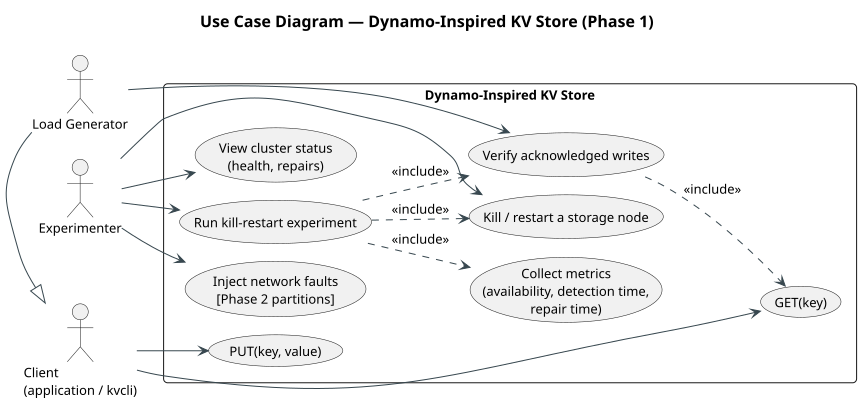

### 2.1 Functional
| ID | Requirement | Source |
|---|---|---|
| F1 | `PUT(key, value)` and `GET(key)`, with a clear success or error result for every request | Proposal goal 1 |
| F2 | Run 4–6 storage-node processes, one per machine | Goal 1 |
| F3 | Place keys on a consistent-hash ring with virtual nodes. The preference list is found by walking the ring clockwise. | Goal 2 |
| F4 | Store every key on N=3 distinct nodes. A PUT is acknowledged after W=2 durable copies. A GET reads R=2 replicas and returns the newest version. | Goal 3 |
| F5 | Heartbeats every 1 s. A node is marked DOWN after 3 missed beats and UP when beats return. Detection time is measured. | Goal 4 |
| F6 | Keep serving GET and PUT with 1 storage node down. Document the behaviour with more than 1 down. | Goal 5 |
| F7 | Append every version to an on-disk log and fsync it **before** acking. Reload the log on restart. | Goal 6 |
| F8 | Replicas build digests, compare them, and copy only missing or stale keys from a healthy replica. | Goal 7 |
| F9 | The client records acknowledged writes and verifies all of them after failure and recovery. | Goal 8 |
| F10 | Kill/restart experiment that measures repair time and request availability, under several loads and key counts | Goal 9 |

### 2.2 Non-functional
- **Safety:** an acknowledged write is never lost while at most 1 replica of a key fails (crash-recovery, disk intact).
- **Availability:** with 1 storage node down, ≥99% of requests should succeed. The only failures should be requests already in flight when the node died.
- **Latency:** single-digit milliseconds on the RCE LAN in the normal case. The floor is fsync cost.
- **Observability:** every component exports counters and timestamps. Experiments compute their metrics from logs, not from guesses.
- **Testability:** fault injection (drop or delay messages to chosen peers) is built in. It is needed for tests now and for Phase 2's partition experiment.

## 3. Failure model and stated tolerance

- **Faults covered:** storage-node processes crash and restart with their local disk intact (crash-recovery). Messages may be delayed or lost. No Byzantine behaviour.
- **Stated tolerance (Phase 1):** N=3, W=2, R=2 means **any 1 storage node may be down at a time** and every key stays readable and writable. Because R + W > N (2 + 2 > 3), every read quorum overlaps every write quorum in at least one node. A read therefore always contacts at least one replica that holds the latest acknowledged write.
- **Beyond tolerance (to be documented and demonstrated):**
  - With 2 nodes down, a key whose 3 replicas include both down nodes has only 1 live replica. PUTs and GETs for that key **fail with an explicit error** (`QUORUM_NOT_REACHED`). Keys with ≥2 live replicas keep working. Safety is preserved because nothing is falsely acknowledged. With 5 nodes and 3 replicas, the fraction of keys affected can be computed from the ring, and we will report it.
  - If 2 replicas of a key **lose their disks permanently**, acknowledged writes can be lost. This is outside the model.
- **Unacknowledged writes:** a PUT that returns an error or a timeout may or may not survive. For example, the coordinator fsyncs locally, then dies before W is reached. Anti-entropy may later spread that write. This is normal Dynamo behaviour, and we state it explicitly.
- **Control-plane faults:** see §9. No single control-plane process sits on the data path such that its failure stops reads or writes.

## 4. Architecture

### 4.1 Mapping from DynamoDB (transcript) to our services

| DynamoDB concept (transcript) | Our component | Phase 1 treatment |
|---|---|---|
| Request Router, with a local routing cache | **Request Router** | Implemented. Stateless. Caches the ring and the health view. |
| Metadata Service (partition → node map) | **Metadata Service** | Implemented. Source of truth for membership, the ring, and config. |
| MemDS (warm in-memory metadata cache, no cascading misses) | Router/node local cache + "keep working when metadata is down" rule | Simplified. With ~5 nodes the whole ring fits in every cache, so a separate MemDS adds nothing. |
| Storage nodes (B-tree + WAL per partition) | **Storage Node** | Implemented. The append-only version log is both WAL and store. An in-memory index serves reads. |
| Leader per partition + Multi-Paxos | **Leaderless quorum** with a per-request coordinator | **Replaced on purpose.** Leaders would reject minority-side writes and make Phase 2 impossible. |
| Log replicas (WAL-only, for fast recovery) | Hinted handoff **[P2/stretch]** | Not in Phase 1. Strict quorums are enough for f = 1. |
| Auto-Admin (fleet health, recovery, rebalancing) | **Auto-Admin Service** | Implemented for health, failure declaration, and repair tracking. No split or rebalance, because membership is static. |
| Gray failures: confirm with peers before acting | Auto-Admin declares DOWN only after peer confirmation (§7.3) | Implemented. |
| Admission control / token buckets / GAC | Token-bucket limiter at the router | Stretch goal. |
| End-to-end checksums, continuous verification | CRC32 per log record, SHA-1 digests, periodic anti-entropy | Implemented. |
| Canary apps measuring what customers see | The load generator measures availability from the client side | Implemented as part of the experiments. |
| Cached dependencies survive outages | Routers and nodes cache the ring. Health falls back to direct probing. | Implemented. |
| Deployments (canary, read-then-write rollout) | — | Out of scope. |

### 4.2 Component diagram

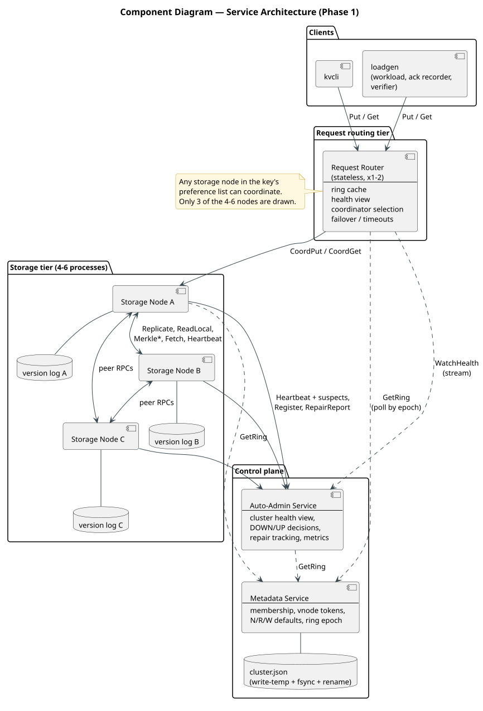

### 4.3 Inside a storage node

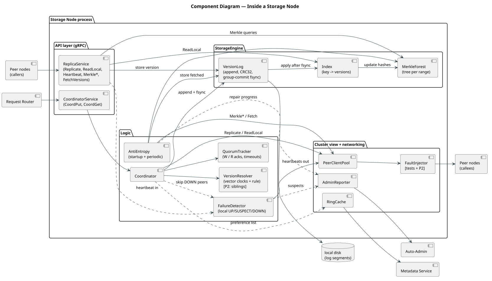

### 4.4 Responsibilities

| Service | Owns | Does NOT do |
|---|---|---|
| **Request Router** | Client API endpoint; the key → preference-list lookup from its cached ring; picking a coordinator (first UP node in the preference list); failover to the next node on error or timeout; per-request timeout; client-facing error codes; request metrics. Optional token-bucket admission control. | Store data. Assign versions. Count quorums. |
| **Metadata Service** | Persistent cluster config: node IDs, addresses, vnode tokens, N/R/W defaults, ring **epoch**. Serves `GetRing`. | Track health. Sit on the data path. |
| **Auto-Admin** | Cluster-wide health view built from heartbeats plus peer suspicion reports. Declares DOWN/UP with peer confirmation. Pushes health to routers. Records failure-detection time. Tracks each repair (start, progress, done) and repair time. Status API for experiments. | Sit on the data path. Do the repair itself (nodes repair peer-to-peer). |
| **Storage Node** | Durable versioned storage; replica role (store and ack); coordinator role (version stamping, quorum fan-out, reconciliation, read repair); peer failure detection; anti-entropy. | Decide cluster membership. |

## 5. Data model and partitioning

- **Keys:** UTF-8 strings (≤1 KiB). **Values:** opaque bytes (≤1 MiB, configurable).
- **Ring:** 64-bit token space. `token(x) = first 8 bytes of MD5(x)` read as an unsigned 64-bit integer. MD5 is used for spread, not security.
- **Virtual nodes:** each physical node owns `V` tokens (default 64), computed as `MD5(nodeId + "#" + i)`. This evens out the load across nodes and spreads a failed node's load over many peers.
- **Preference list(key):** start at `token(key)` and walk clockwise. Collect the first **N distinct physical nodes**. The first entry is the *primary*, which is the preferred coordinator.
- **Membership is static in Phase 1.** It is defined in the Metadata Service config. A crashed node is still a member while it is DOWN, so failures never move data ownership (same as Dynamo). Adding and removing nodes is future work. The ring epoch exists so that it can be added later.
- **Ring ranges:** the arc between two consecutive tokens is a *range*. Each range has exactly N replica nodes. Ranges are the unit of anti-entropy.

## 6. Versioning and conflict resolution

Each stored version is the tuple `(value, vector_clock, timestamp_ms, coordinator_id, tombstone=false)`. The tombstone field is reserved for a later DELETE.

- **Vector clock:** a map `nodeId → counter`. Only coordinators increment their own entry.
- **Stamping a PUT (Phase 1, `READ_BEFORE_WRITE`):** the client sends no context. The coordinator reads the key's current clocks (metadata only) from R−1 other replicas, merges them (element-wise max) with its local clocks, increments its own entry, and attaches its wall-clock timestamp. Because R + W > N, the clocks it reads always include the last acknowledged version. A new PUT therefore always *descends from* every earlier acknowledged PUT, and the result never depends on wall clocks (RCE clocks are not reliably synced; see milestone 0). Cost: one extra metadata round trip (~0.8 ms). Rationale and proof are in LLD §7.1. **[P2]** The client passes the context it last read, and the coordinator uses it as the base.
- **Comparison:** for clocks *a* and *b*, either *a* < *b* (b descends from a), *a* > *b*, they are equal, or they are **concurrent**.
- **Storage rule:** a replica stores a new version unless an existing version already dominates or equals it. Versions it dominates become *obsolete*. They stay in the log because the proposal requires every version to be kept, but they are dropped from the "current" set in the index.
- **Declared resolution rule (Phase 1):** a GET collects the current versions from R replicas.
  1. Drop any version dominated by another one.
  2. If more than one remains (concurrent siblings), pick the winner by the highest `timestamp_ms`, and break ties by the lowest `coordinator_id`. This is deterministic last-writer-wins applied to concurrent versions only.

  In Phase 1, concurrent versions only appear in edge cases, such as two routers failing over to different coordinators for the same key at the same moment. **[P2]** Step 2 becomes optional: GET returns all siblings and their merged context, and the client reconciles.

## 7. Key flows

### 7.1 PUT (W = 2)
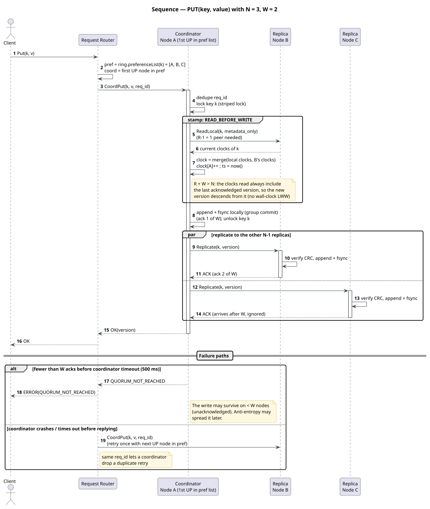

Text summary:
```
Client ──Put(k,v)──▶ Router
Router: pref = ring.preferenceList(k); coord = first UP node in pref
Router ──CoordPut(k,v,req_id)──▶ coord
coord:  lock k ; clock = merge(local clocks, clocks from R-1 peers) ; clock[coord]++ ; ts = now
        append+fsync locally (group commit) → ack #1 ; unlock k
        ──Replicate(k,version)──▶ other 2 replicas (parallel)
             replica: CRC check, append+fsync, ack
        on W acks (incl. self)  → reply OK(version) to Router → Client
        on timeout with < W acks → reply QUORUM_NOT_REACHED
        late acks are ignored; a replica that missed the write is fixed later by anti-entropy
Router: on coord error/timeout before any reply → retry once with next UP node in pref
```
- A coordinator always belongs to the key's preference list (**strict quorum**). If fewer than W preference-list nodes are reachable, the PUT fails explicitly.
- `req_id` lets the coordinator deduplicate a retried PUT. This avoids two versions when the router retries after a slow first attempt.

### 7.2 GET (R = 2)
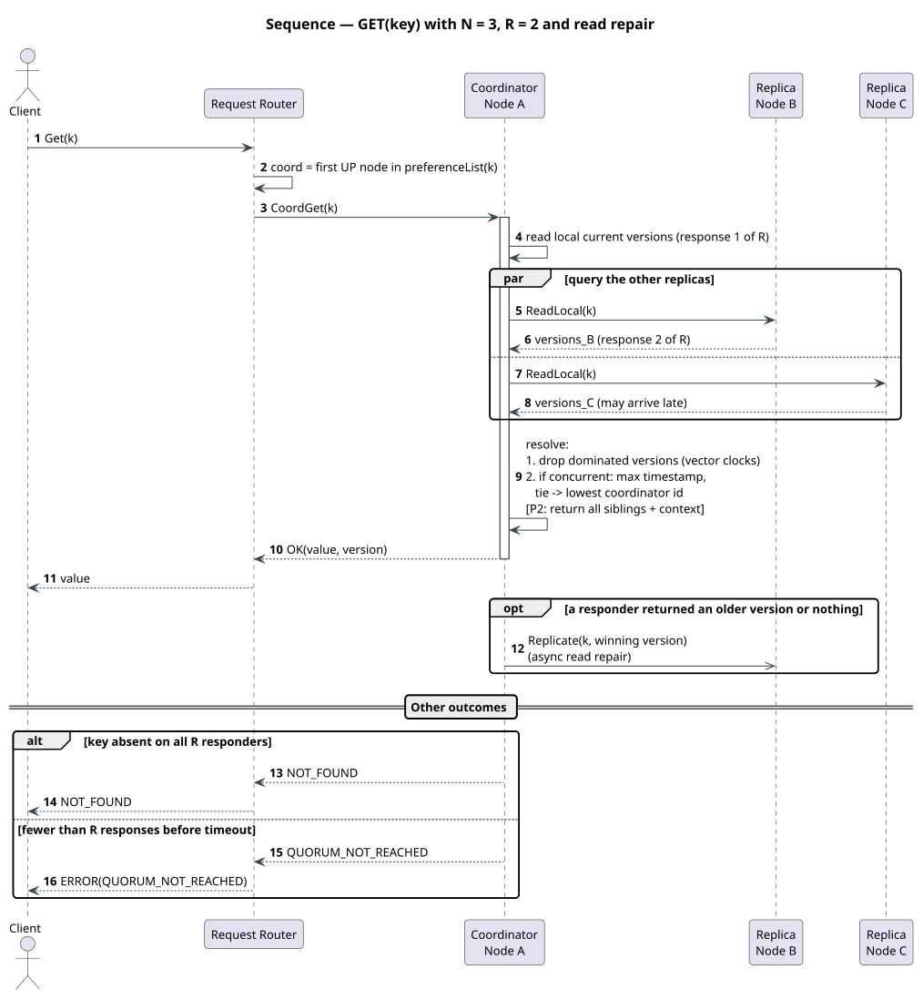

Text summary:
```
Router ──CoordGet(k)──▶ coord (first UP in pref)
coord:  read local current versions; ReadLocal(k) on the other replicas, in parallel
        wait for R responses (incl. self), timeout → QUORUM_NOT_REACHED
        resolve (§6) → reply value + version (+ context [P2])
        read repair (async): send winning version to any responder that lacked it
```
A missing key returns `NOT_FOUND`, which is distinct from an error.

### 7.3 Failure detection (heartbeats)
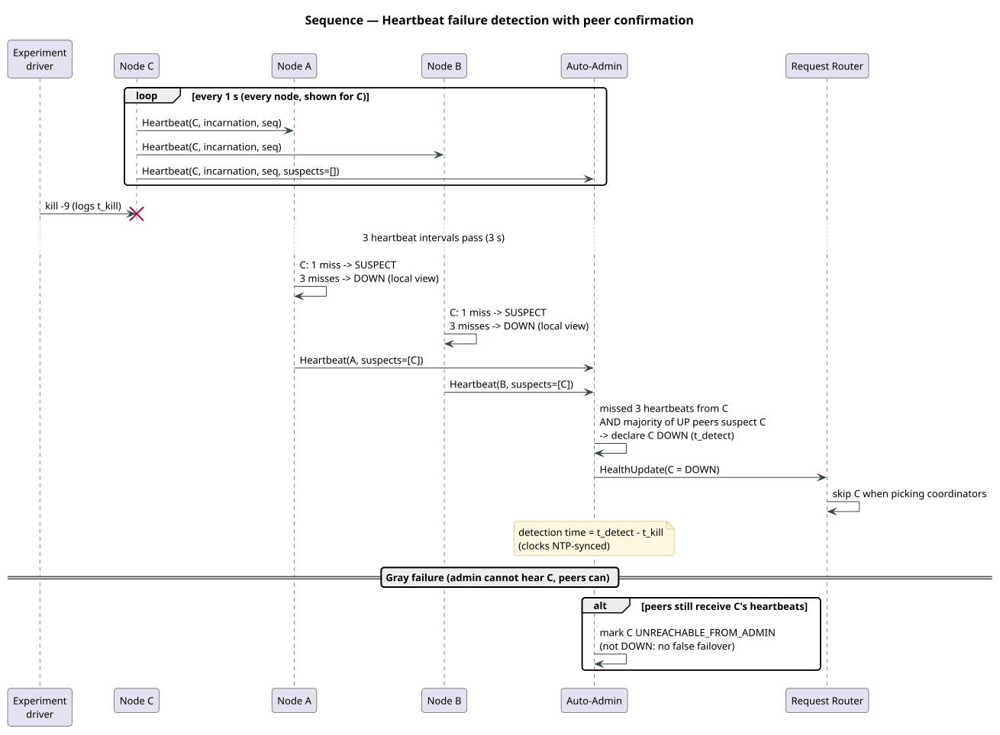

- Every **1 s**, each storage node sends `Heartbeat(nodeId, incarnation, seq, suspects[])` to every peer and to the Auto-Admin. `incarnation` increases on every restart and lets receivers notice a restart.
- **Local view (per node):** a peer is SUSPECT after 1 missed interval and DOWN after **3 missed** intervals (3 s). It returns to UP on the next heartbeat. Coordinators use the local view to avoid waiting on DOWN replicas. They also never wait longer than the request timeout.
- **Cluster view (Auto-Admin):** a node is declared DOWN when the admin has missed 3 of its heartbeats **and** a majority of the other UP nodes report it as a suspect. This is the transcript's "confirm with other replicas first" rule against gray failures. If the admin misses beats but peers still see the node, it is flagged `UNREACHABLE_FROM_ADMIN`, not DOWN. When a DOWN node sends a heartbeat or registers with a new incarnation, it moves to **RECOVERING**: a *recovery* is recorded and the repair timer starts. It moves to UP when it reports `REPAIR_DONE`. A RECOVERING node is routable: it accepts writes and serves reads (see §7.4 for why reads stay correct).
- Routers subscribe to the admin's health stream. If the admin is down, they fall back to their last view plus failover on error.
- **Measured:** detection time is taken **on the Auto-Admin's own clock**: time it declared DOWN − time it last received a heartbeat from the node. The experiment driver also issues the kill from the Auto-Admin's machine and logs that time too. Milestone 0 found RCE clocks are not reliably synced (node03 unsynced, node06 synced), so no reported duration mixes clocks from two machines.

| Local view (each storage node) | Cluster view (Auto-Admin) |
|---|---|
| 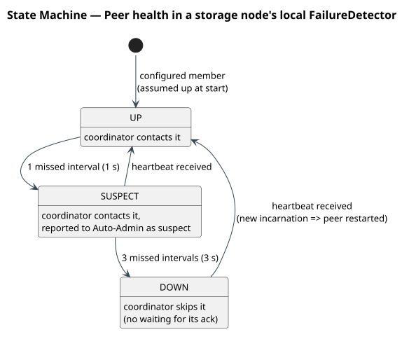 | 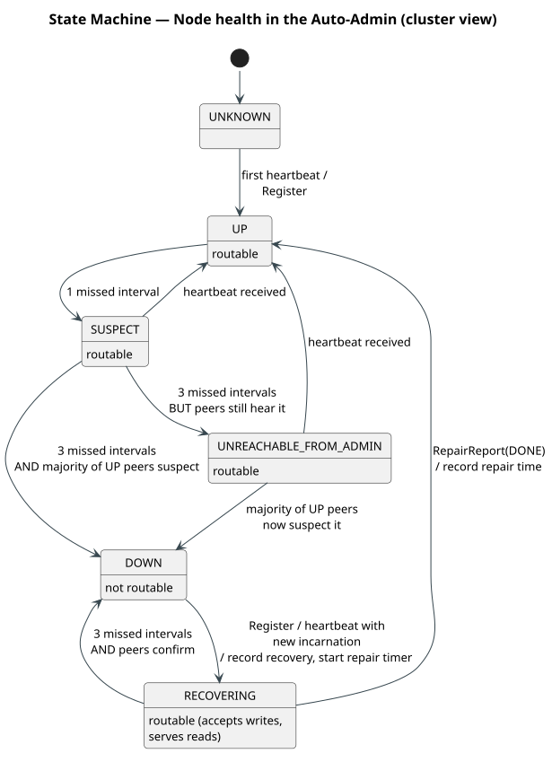 |

### 7.4 Anti-entropy repair
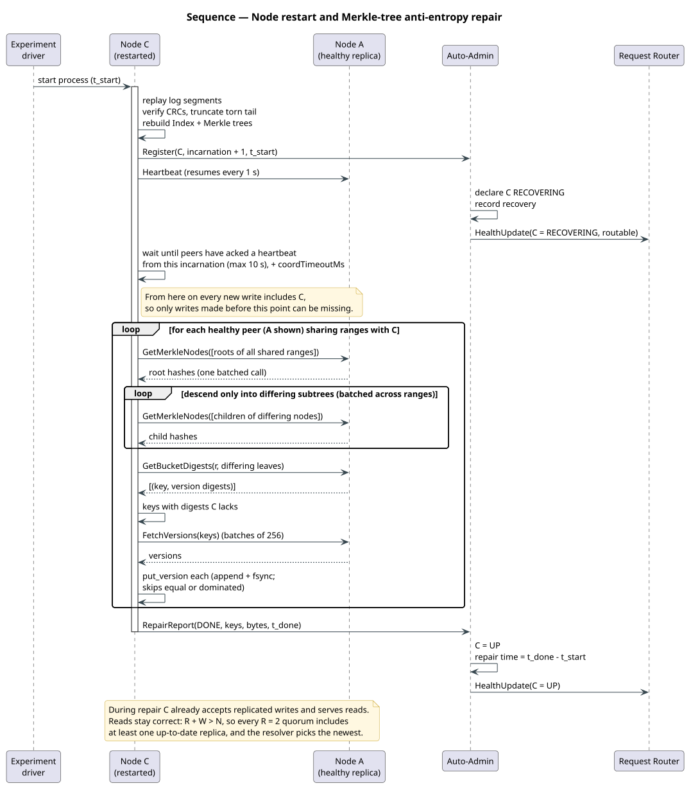

- Each node keeps, **per ring range it replicates**, a Merkle tree with a fixed fan-out over hash buckets of the key space. A leaf hash covers the sorted `(key, version-digest)` pairs in its bucket. Trees are updated incrementally on every write.
- **On restart:**
  1. Replay the log and rebuild the index and the Merkle trees.
  2. Register with the Auto-Admin (new incarnation) and start heartbeating.
  3. Wait until the peers have acknowledged a heartbeat from this incarnation, so every new write already includes this node. Then, for every healthy peer, exchange Merkle roots for all shared ranges in batched calls. Descend only into subtrees that differ. In each mismatched leaf, compare per-key version digests and **fetch only missing or newer versions**.
  4. Store each fetched version durably, exactly like a replicated write.
  5. When one full pass over every healthy peer is complete, report `REPAIR_DONE`. At that point every version stored before the pass started is local. Exact root equality is not the test, because writes are always in flight under load (LLD §7.6).
- **Periodic:** every node also runs the same exchange in the background (default every 30 s, one range at a time) to catch anything missed. This is the continuous verification idea.
- **Serving during repair:** the restarted node accepts replicated writes at once. Reads are still correct, because any R=2 quorum includes at least one up-to-date replica (§3) and the resolver picks the newest version.
- **Measured:** repair time = `REPAIR_DONE` time − process start time. **Both timestamps come from the restarted node's own clock.** The node reports them, and the Auto-Admin records them. We also record the number of keys and bytes transferred.

## 8. Durability

- **Version log:** one append-only file per node (segmented when it grows large). Each record is `[len | crc32 | type | payload]`. A write is acknowledged (to the coordinator or the client) **only after `fsync` returns**.
- **Group commit:** concurrent writes that arrive close together share one fsync. This keeps throughput reasonable without weakening "fsync before ack".
- **Recovery:** on startup, scan all segments, verify the CRCs, truncate a torn tail record (a crash mid-append), then rebuild the index and the Merkle trees.
- **Snapshots and compaction:** optional (a stretch goal). Not needed for correctness.
- **Metadata Service:** its config file is written with write-to-temp + fsync + rename.

## 9. Control-plane availability (lessons from the transcript)

| Failure | Effect | Mitigation |
|---|---|---|
| Router crash | Clients connected to it get errors | Routers are stateless. Run 2. The client library retries on the other router. |
| Metadata Service down | No new ring fetches | Routers and nodes keep using the cached ring (epoch unchanged). The data path is unaffected. Only membership changes, which don't exist in Phase 1, are blocked. |
| Auto-Admin down | No cluster-wide health view, no repair *tracking* | The data path uses local peer heartbeats and router failover. Nodes still run repair themselves. Only metrics and timestamps pause. |
| Storage node down | Covered by the f = 1 tolerance | Quorums, failover, and anti-entropy. |

## 10. Deployment (RCE, 8 machines)

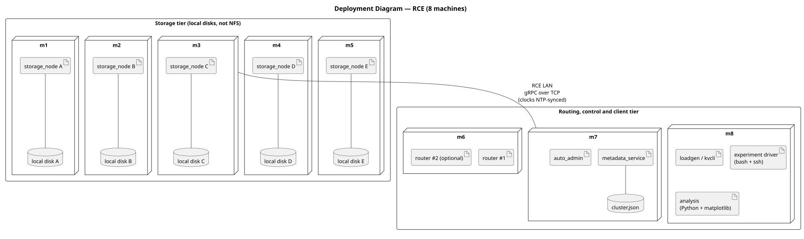

| Machine | Role |
|---|---|
| m1–m5 | Storage nodes A–E (5 nodes, which is inside 4–6; leaves room to also run 4 or 6) |
| m6 | Request Router #1 (+ optional Router #2) |
| m7 | Metadata Service + Auto-Admin (different processes) |
| m8 | Client / load generator / experiment driver |

- **RCE is a SLURM cluster** (compute nodes node01–08). The experiment driver runs inside one `sbatch` job that allocates all 8 nodes (`-N 8`). It starts each process with `srun -w <node>`, or with ssh, which SLURM allows into nodes the job holds. Machine names m1–m8 map to whichever nodes SLURM assigns. **Nothing runs on the login node** except `sbatch` itself.
- On 2026-11-09 only node03–06 were schedulable (the others were drained). The team expects all 8 back for the experiments. Until then, development runs use a 4-machine layout from the same config: 4 storage nodes, one per machine, with the router/control/client processes sharing machines.
- Binaries are built once per change **on a compute node** (`module load cmake/3.20.3 gRPC/1.74.1`; verified in milestone 0). They live on the NFS-shared `/home`, so every node runs the same build.
- Every node writes data to its **local** `/tmp/<user>/dynamo-kv/` (xfs; `/home` is NFS) and keeps an event log there. Logs are copied back to `/home` at the end of each run.
- The experiment driver runs on the Auto-Admin's machine (m7) and issues `kill -9` from there, so kill and detection timestamps share one clock (§7.3).

## 11. Experiments and metrics

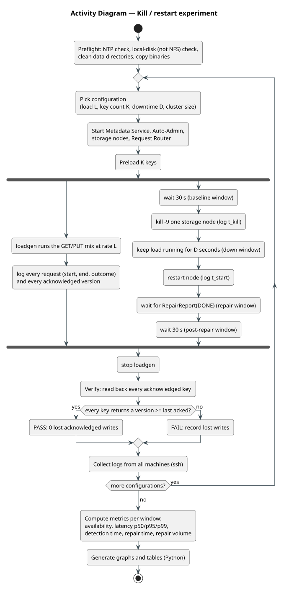

**Main experiment (repeated for each load level and key count):**
1. Start the cluster and preload K keys.
2. Start loadgen with a GET/PUT mix (default 50/50) at a target rate. Loadgen logs every request: start time, end time, outcome, and the acknowledged version.
3. At T+30 s, `kill -9` one storage node (logging the kill time).
4. Keep the load running while the node is down (e.g. 60 s).
5. Restart the node and wait for `REPAIR_DONE`.
6. Stop the load. Read back every acknowledged key and check that the returned version is equal to or newer than the last acknowledged version.

**Metrics:**
| Metric | Definition |
|---|---|
| Request availability | Successful requests ÷ all requests, computed per window: before the kill, while down, during repair, and after |
| Failure-detection time | Admin DOWN timestamp − kill timestamp |
| Repair time | `REPAIR_DONE` − node process start |
| Repair volume | Keys and bytes fetched during repair |
| Lost acknowledged writes | Must be **0** |
| Latency | p50/p95/p99 for GET and PUT, per window |

**Variations:** load (e.g. 100 / 500 / 2000 req/s), key count (1k / 10k / 100k), downtime length, and cluster size (4 vs 6). Also a "2 nodes down" run that shows the documented behaviour beyond tolerance.

**Outputs:** CSV files from loadgen and the admin, plus Python/matplotlib scripts that make the graphs and tables for the report.

## 12. Phase 2 extension points

| Phase 2 need | Prepared in Phase 1 by | Change needed in Phase 2 |
|---|---|---|
| Client-set R and W | `Put`/`Get` requests already carry optional `r`/`w` fields. Phase 1 ignores them and uses the defaults 2/2. | Honour the fields. Validate 1 ≤ R, W ≤ N. |
| Vector clocks for concurrent writes | Every version already stores a vector clock, and the resolver already detects concurrency. | None in storage. |
| Return conflicting versions | The resolver has a policy switch; Phase 1 uses `LWW_ON_CONCURRENT`. | Add `RETURN_SIBLINGS`. GET returns a list plus the merged context. |
| Client context on PUT | The request has an optional `context` field. | The coordinator uses it as the clock base. Siblings are collapsed when the client writes back. |
| Network partitions | `FaultInjector` can drop traffic to and from chosen peers, controlled via an admin RPC. | Script the two-sided partition experiment. |
| Writes on both sides of a partition | Leaderless coordinators: any preference-list node can coordinate. | Optional: sloppy quorum + hinted handoff, so W is met on the minority side. |
| Stale-read frequency | Loadgen already logs the returned version for every read. | Compare it with the latest acknowledged version and report per R/W setting. |

## 13. Technology choices

| Item | Choice | Reason |
|---|---|---|
| Language | **C++17** (team decision: C++; standard fixed by RCE) | RCE's `gRPC/1.74.1` module was built with GCC 8.5 in C++17 mode. Matching it avoids Abseil/libstdc++ ABI problems. Verified in milestone 0. |
| RPC | gRPC + Protocol Buffers (sync API with a thread pool, async calls for fan-out) | Proposal |
| Build | CMake. On RCE: `module load cmake/3.20.3 gRPC/1.74.1` on compute nodes (they have no system cmake). Locally: gRPC/Protobuf from system packages. | Standard for gRPC C++. Verified on RCE in milestone 0. |
| Hashing | MD5 (ring), SHA-1 (digests), CRC32 (log records); via OpenSSL or a small bundled implementation | Proposal |
| Storage | Custom append-only segmented log + in-memory index. No RocksDB in Phase 1. | Simpler to explain and measure. Shows the durability mechanism directly. |
| Config | One cluster config file (YAML or JSON) shared by all processes | — |
| Tests | GoogleTest (unit), plus multi-process integration tests on localhost | — |
| Experiments | Bash + ssh (orchestration), Python + matplotlib (analysis) | — |

## 14. Risks

| Risk | Mitigation |
|---|---|
| ~~Building gRPC-C++ on RCE is slow or blocked~~ | **Resolved (milestone 0):** the `gRPC/1.74.1` module works. The build takes 32 s on a compute node. Binaries are statically linked to gRPC and run on any node from the shared `/home`. |
| fsync on RCE disks is slow, so latency is high | Group commit. Report fsync cost separately. |
| RCE disks turn out to be NFS | **Confirmed for `/home`** (nfs4). Compute-node `/tmp` is local xfs (fsync p50 0.07–0.16 ms), so all node data goes to `/tmp`. |
| Clock skew distorts the measured times | **Observed:** node03 unsynced, node06 synced. Every reported duration is measured on a single machine's clock (§7.3, §7.4). |
| Only 4 of 8 RCE compute nodes are schedulable (node01/02/07/08 drained by admins); nodes are shared with other users | Scripts read process placement from config and work with 4–6 machines. Ask course staff about the drained nodes. Deployment layout to be confirmed by the team (§10). |
| No workloads allowed on the login node (team rule) | Everything runs through `sbatch`/`srun` on compute nodes. The login node only submits jobs and reads job output. |
| Concurrency bugs in C++ | Keep locking simple (one index mutex plus the group-commit queue). Run tests under ThreadSanitizer. |

## 15. Implementation milestones (overview, detailed in the LLD)

0. Toolchain: CMake + gRPC "hello" built locally **and** run on RCE.
1. Protos, config loader, ring + preference list (unit tests).
2. Storage engine: version log, CRC, fsync, group commit, recovery, index (unit tests plus crash tests).
3. Vector clocks + resolver (unit tests).
4. Storage node: replica RPCs, coordinator PUT/GET with quorums, read repair.
5. Metadata Service, Request Router, kvcli → first end-to-end demo.
6. Failure detector + Auto-Admin (health view, peer confirmation, router health stream).
7. Merkle trees + anti-entropy (startup + periodic), repair tracking.
8. Loadgen, ack recorder, verifier; FaultInjector.
9. Experiment scripts for RCE, analysis scripts, graphs, README.
10. Stretch: router token-bucket admission control, snapshots/compaction, second router.

## 16. Open items (defaults assumed unless the team changes them)

- Number of storage nodes in the main runs: **5**.
- Virtual nodes per node: **64**.
- Request timeout: **500 ms** coordinator-side, **1 s** at the router.
- Periodic anti-entropy interval: **30 s**.
- Routers deployed: **1** for the main runs, with 2 supported.
