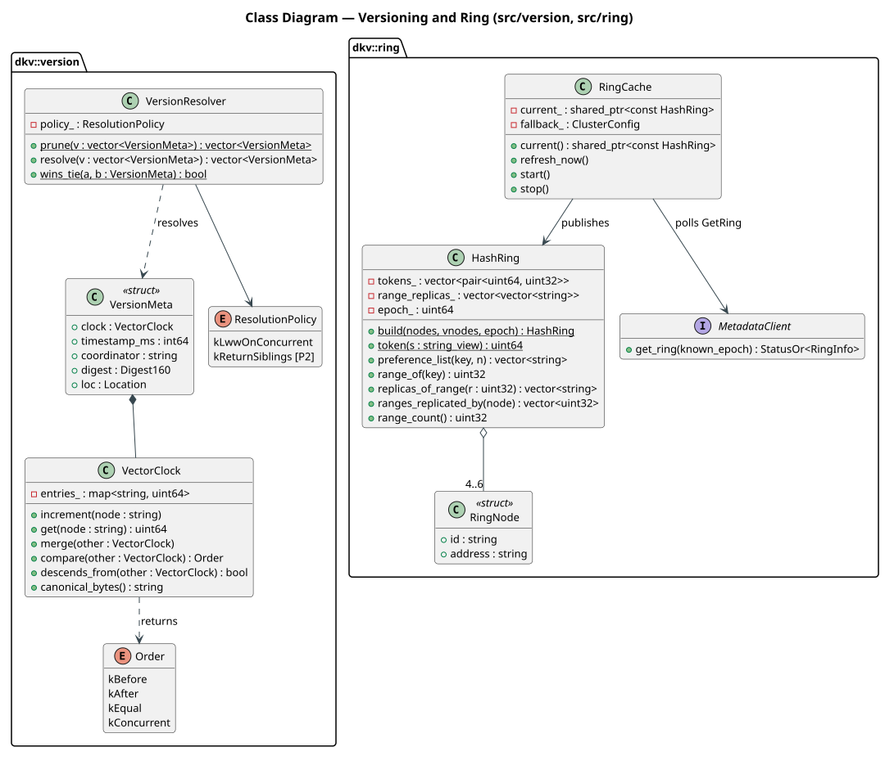
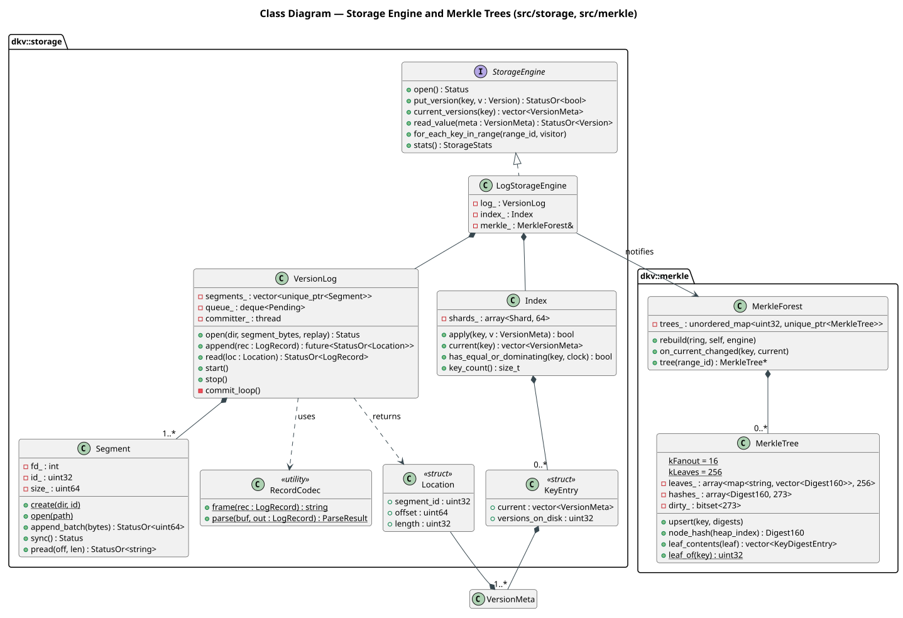
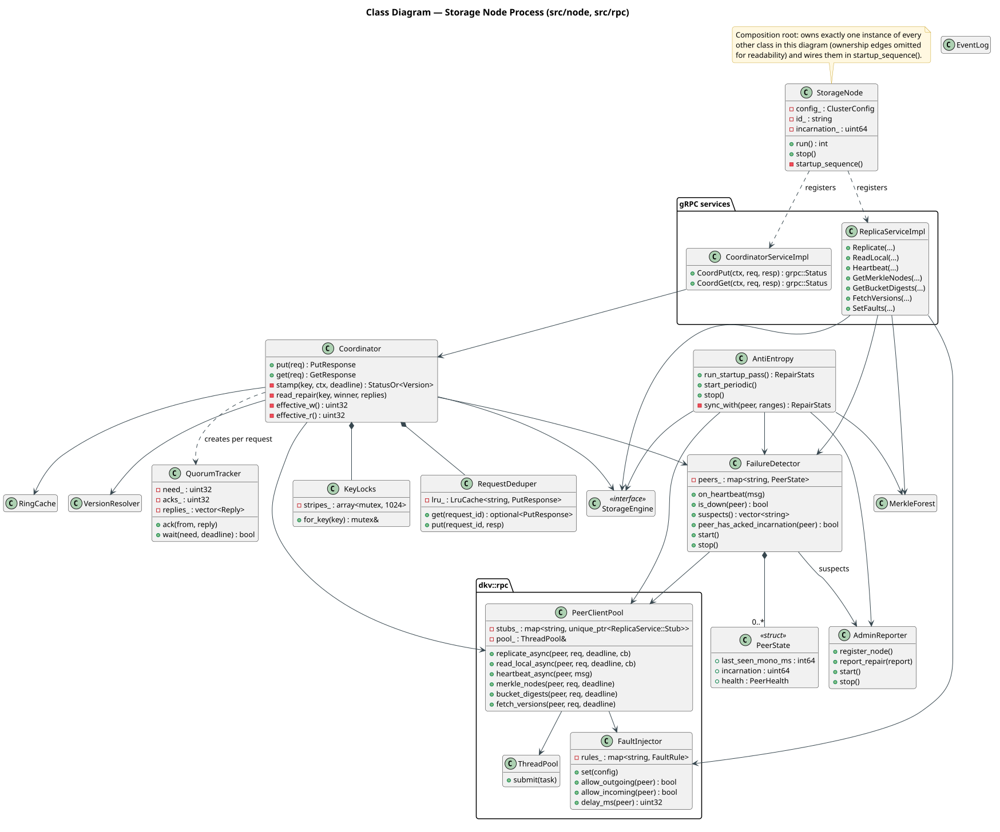
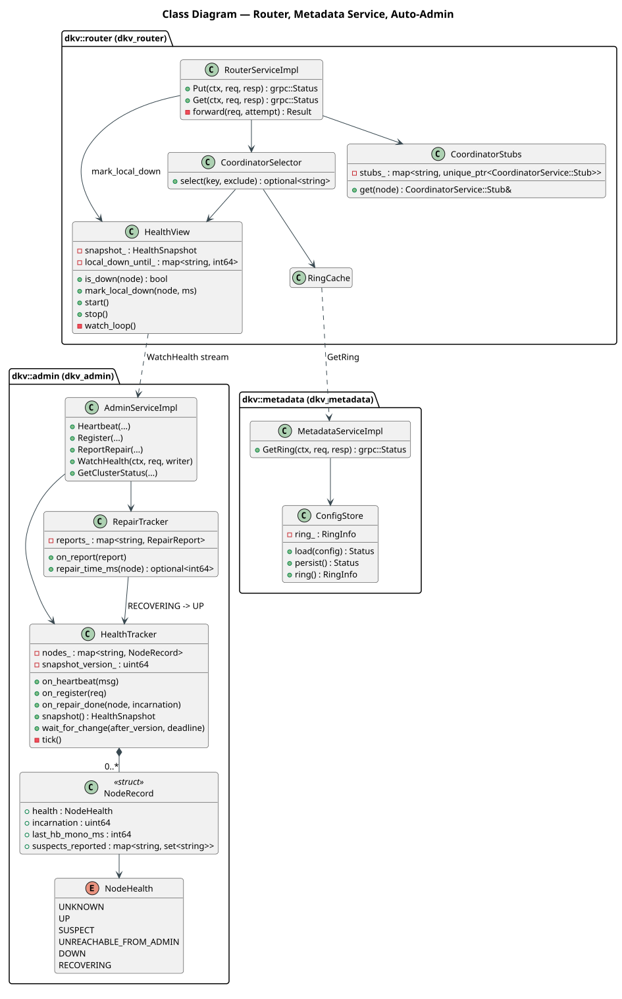
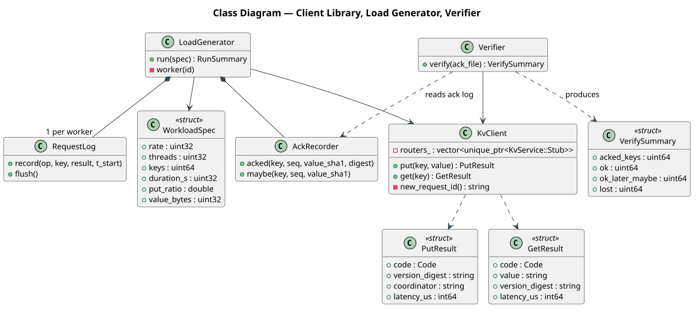
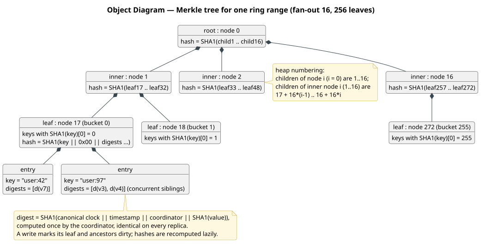
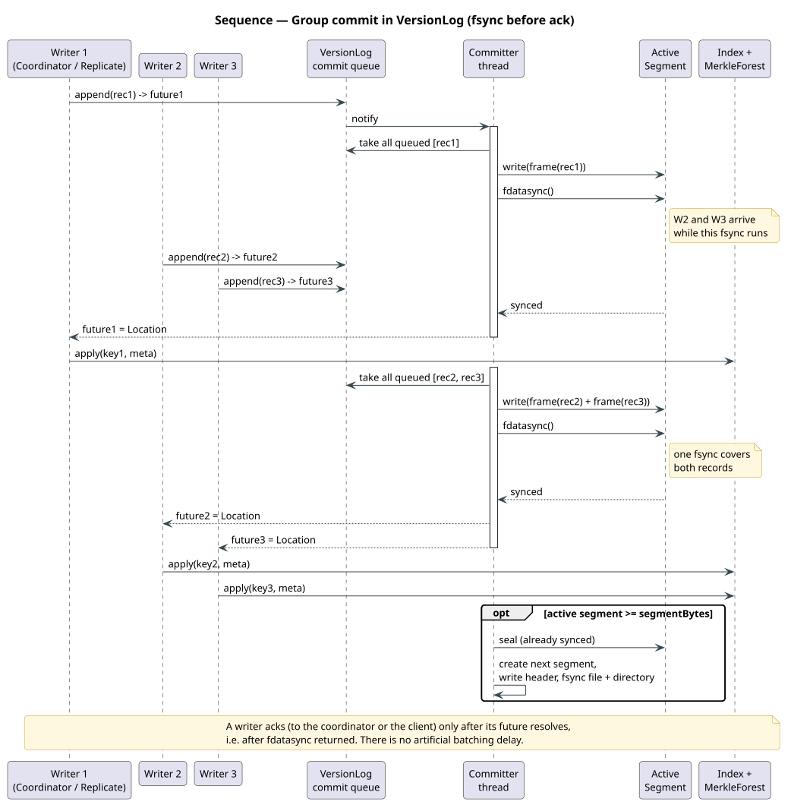
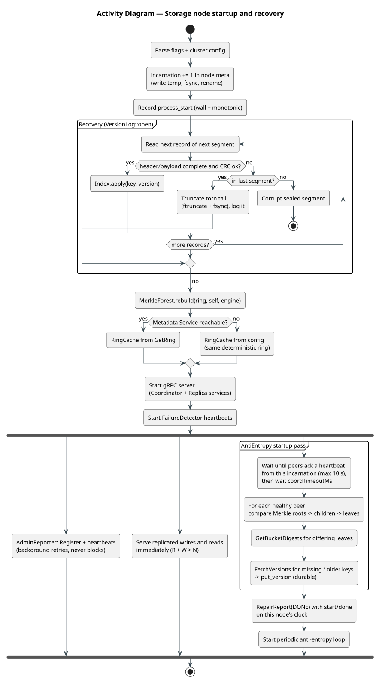

# Low-Level Design — Dynamo-Inspired Fault-Tolerant Key-Value Store

Team 18 · Dhruv Rajput (2025201094) · Sohail Memon (2025201075)
Status: **Draft v1 (2026-11-09)**. Builds on [HLD.md](../hld/HLD.md) (read it first). Terms: **Phase 1** = course Project 1 (this build). **Phase 2** = course Project 2, added after the coursework. **[P2]** marks a Phase 2 hook.

---

## 0. Diagram index

These are the LLD's own diagrams; the HLD's diagrams are in [`../hld/diagrams/`](../hld/diagrams/). Sources are in [`diagrams/src/`](diagrams/src/). Compiled output is in [`diagrams/out/`](diagrams/out/). Rebuild all diagrams with `docs/build_diagrams.sh`.

| Diagram | UML type | Section |
|---|---|---|
| [class-core](diagrams/out/class-core.svg) | Class: versioning + ring | §5.1, §5.2 |
| [class-storage](diagrams/out/class-storage.svg) | Class: storage engine + Merkle | §5.3, §5.4 |
| [class-node](diagrams/out/class-node.svg) | Class: storage-node process | §5.5 |
| [class-control](diagrams/out/class-control.svg) | Class: router, metadata, admin | §5.6–§5.8 |
| [class-client](diagrams/out/class-client.svg) | Class: client, loadgen, verifier | §5.9 |
| [seq-group-commit](diagrams/out/seq-group-commit.svg) | Sequence | §7.4 |
| [activity-node-startup](diagrams/out/activity-node-startup.svg) | Activity | §7.7 |
| [merkle-layout](diagrams/out/merkle-layout.svg) | Object | §6.4 |

---

## 1. Conventions

| Topic | Rule |
|---|---|
| Language | **C++17** (HLD D8). Must build with GCC 8.5 + gRPC 1.74.1 on RCE, and with the local Ubuntu toolchain. Use only gRPC/protobuf APIs that are stable across those versions. |
| Namespace | `dkv` (sub-namespaces per module: `dkv::storage`, `dkv::node`, …) |
| Naming | `PascalCase` types, `snake_case` functions and variables, `kConstant`, trailing `_` for members |
| Errors | No exceptions across module boundaries. Functions return `dkv::Status` (code + message) or `StatusOr<T>`. gRPC transport failures are mapped at the RPC boundary (§8). |
| Ownership | `std::unique_ptr` for owned components. Plain references for non-owning dependencies passed at construction. No global singletons except the process logger. |
| Time | `Clock` interface with `now_wall_ms()` and `now_mono_ms()`, injectable for tests. Durations use the monotonic clock. Wall time is used only for version timestamps and log lines. |
| Threads | Every long-running component has `start()` / `stop()` and owns its threads. `stop()` joins them. |
| Dependencies | gRPC, protobuf, pthreads, and a vendored single header `third_party/doctest.h` for unit tests. MD5, SHA-1, and CRC32C are implemented in `src/common/` (small, test-vector-checked), so OpenSSL is not needed. Config JSON is parsed with protobuf's `JsonStringToMessage`, so no JSON library is needed. |

## 2. Repository layout

As built (updated 2026-11-09). Where files were merged or renamed compared with the original design, §16 lists the change.

```
CMakeLists.txt                  top-level; options DKV_BUILD_TESTS, DKV_SANITIZE (thread|address)
cmake/Dependencies.cmake        find_package(protobuf CONFIG) + find_package(gRPC CONFIG), RCE libsystemd fix
proto/
  CMakeLists.txt  common.proto  kv.proto  node.proto  admin.proto  metadata.proto  config.proto   (package dkv.wire)
src/
  common/    status.{h,cc}  clock.h  hash.{h,cc} (md5, sha1, crc32c)  logging.{h,cc}  event_log.{h,cc}
             thread_pool.{h,cc}  flags.{h,cc}  config_loader.{h,cc}  fs.{h,cc}  signals.{h,cc}
  version/   vector_clock.{h,cc}  version.{h,cc} (Version, VersionResolver)
  ring/      hash_ring.{h,cc}
  storage/   record_codec.{h,cc}  segment.{h,cc}  version_log.{h,cc}  index.{h,cc}
             storage_engine.h  log_storage_engine.cc
  merkle/    merkle_tree.{h,cc} (MerkleTree, MerkleForest)
  rpc/       rpc_util.{h,cc}  peer_client_pool.{h,cc}  fault_injector.{h,cc}  ring_cache.{h,cc}
  node/      main.cc  storage_node.{h,cc}  coordinator.{h,cc}  quorum.h  services.{h,cc}
             failure_detector.{h,cc}  anti_entropy.{h,cc}  admin_reporter.{h,cc}
  router/    main.cc  router.{h,cc} (HealthView, RouterServiceImpl)
  metadata/  main.cc
  admin/     main.cc  health_tracker.{h,cc}
  client/    kv_client.{h,cc}
  tools/     kvcli.cc  loadgen_main.cc  verify_main.cc  workload.{h,cc}
tests/
  test_framework.h  test_main.cc   in-repo TEST_CASE/CHECK harness
  unit/          common_test.cc  version_ring_test.cc  storage_test.cc  merkle_test.cc
config/
  cluster.local.json            4 storage nodes on 127.0.0.1, different ports (RCE configs are generated)
scripts/
  local/     cluster.sh  experiment.sh  integration_tests.sh
  rce/       ssh.sh  askpass.sh  sync.sh  m0_toolchain.sbatch  build.sbatch  experiment.sbatch  make_config.py
  analysis/  analyze_run.py  summarize.py
docs/
  README.md                     index of the design documents
  build_diagrams.sh             renders every diagram (PlantUML, Java only)
  plantuml-style.iuml           shared diagram style
  hld/  HLD.md  diagrams/{src,out}/
  lld/  LLD.md  diagrams/{src,out}/
results/                        experiment summaries and charts from RCE runs
```

**Executables** (all take `--config <file>`; per-process flags shown):

| Binary | Flags | Purpose |
|---|---|---|
| `dkv_node` | `--id A` | Storage node |
| `dkv_router` | `--id R1` | Request router |
| `dkv_metadata` | — | Metadata service |
| `dkv_admin` | — | Auto-Admin |
| `dkv_cli` | `put <k> <v>` · `get <k>` · `status` · `faults <node> <json>` | Manual client and admin tool |
| `dkv_loadgen` | `--rate --keys --duration --put-ratio --value-bytes --out <dir>` | Workload + request log + ack log |
| `dkv_verify` | `--acks <file>` | Reads back every acknowledged key |
| `dkv_tests` | doctest args | Unit tests |

**CMake targets:** one static library per module (`dkv_common`, `dkv_version`, `dkv_ring`, `dkv_storage`, `dkv_merkle`, `dkv_rpc`, `dkv_proto`, …). Executables link only what they need. Library dependencies point strictly one way: `common ← version ← ring/storage ← merkle ← rpc ← node/router/admin/metadata ← tools`.

## 3. Configuration

The config is a protobuf message (`config.proto`) written as JSON and loaded with `google::protobuf::util::JsonStringToMessage`. Every process reads the same file. Missing fields fall back to the defaults below (applied in `ConfigLoader`).

```json
{
  "clusterName": "dkv-rce",
  "storageNodes": [
    {"id": "A", "host": "node03", "port": 7001},
    {"id": "B", "host": "node04", "port": 7001},
    {"id": "C", "host": "node05", "port": 7001},
    {"id": "D", "host": "node06", "port": 7001}
  ],
  "routers":  [{"id": "R1", "host": "node03", "port": 7100}],
  "metadata": {"host": "node04", "port": 7200},
  "admin":    {"host": "node04", "port": 7300},
  "quorum":   {"n": 3, "r": 2, "w": 2},
  "vnodesPerNode": 64,
  "timing": {
    "heartbeatIntervalMs": 1000, "suspectAfterMissed": 1, "downAfterMissed": 3,
    "detectorTickMs": 100, "coordTimeoutMs": 500, "routerTimeoutMs": 1000,
    "antiEntropyIntervalS": 30, "ringPollIntervalS": 5
  },
  "storage": {"dataDir": "/tmp/${USER}/dynamo-kv", "segmentBytes": 67108864},
  "policy":  {"resolution": "LWW_ON_CONCURRENT", "stamping": "READ_BEFORE_WRITE"}
}
```

| Key | Default | Notes |
|---|---|---|
| `quorum.n/r/w` | 3/2/2 | Validated: 1 ≤ r,w ≤ n ≤ number of storage nodes. Phase 1 refuses R + W ≤ N (prints the reason). **[P2]** allows it and allows per-request overrides. |
| `vnodesPerNode` | 64 | |
| `timing.*` | as shown | Heartbeat 1 s. DOWN after 3 missed beats (HLD §7.3). |
| `storage.dataDir` | `/tmp/${USER}/dynamo-kv` | `${USER}` and `${ID}` are expanded. Each node uses `<dataDir>/<id>/`. |
| `storage.segmentBytes` | 64 MiB | |
| `policy.resolution` | `LWW_ON_CONCURRENT` | **[P2]** `RETURN_SIBLINGS` |
| `policy.stamping` | `READ_BEFORE_WRITE` | `LOCAL_ONLY` is kept for comparison experiments (§7.1). **[P2]** client context replaces both. |

On RCE, `scripts/rce/make_config.py` fills `host` fields from `scontrol show hostnames $SLURM_JOB_NODELIST` and a placement map (`m1..m8 → roles`, HLD §10).

## 4. Protocol definitions (proto3)

These are the exact contents of `proto/*.proto` for Phase 1. Field numbers are stable. **[P2]** fields already exist and are ignored by Phase 1.

### 4.1 `common.proto`
```proto
syntax = "proto3";
package dkv;

message VectorClock {                // node id -> counter. Canonical order (sorted by id) is applied
  map<string, uint64> entries = 1;   // whenever a clock is hashed or compared; map order is never relied on.
}

message Version {
  bytes       value          = 1;    // omitted (empty) in metadata-only replies
  VectorClock clock          = 2;
  int64       timestamp_ms   = 3;    // coordinator wall clock; used only as the concurrent tie-break
  string      coordinator_id = 4;
  bool        tombstone      = 5;    // reserved for a future DELETE
  bytes       digest         = 6;    // SHA-1 over canonical (clock, timestamp, coordinator, SHA-1(value)), 20 bytes
}

enum Code {
  OK = 0;  NOT_FOUND = 1;  QUORUM_NOT_REACHED = 2;  INVALID_ARGUMENT = 3;
  UNAVAILABLE = 4;  TIMEOUT = 5;  NOT_A_REPLICA = 6;  INTERNAL = 7;
}
message Result { Code code = 1; string message = 2; }
message Empty  {}
```

### 4.2 `kv.proto` — client API (served by the router; the same messages are reused router → coordinator)
```proto
syntax = "proto3";
package dkv;
import "common.proto";

service KvService {
  rpc Put(PutRequest) returns (PutResponse);
  rpc Get(GetRequest) returns (GetResponse);
}

message PutRequest {
  string      key        = 1;
  bytes       value      = 2;
  string      request_id = 3;   // client-generated UUID; lets a coordinator drop a duplicate retry
  uint32      w          = 4;   // [P2] 0 = cluster default
  VectorClock context    = 5;   // [P2] clock the client last read
}
message PutResponse {
  Result  result      = 1;
  Version version     = 2;      // value omitted
  string  coordinator = 3;
  uint32  acks        = 4;      // durable copies when the reply was sent (>= W on OK)
}

message GetRequest {
  string key = 1;
  uint32 r   = 2;               // [P2] 0 = cluster default
}
message GetResponse {
  Result           result      = 1;
  repeated Version versions    = 2;   // Phase 1: exactly one on OK. [P2] RETURN_SIBLINGS: all siblings
  VectorClock      context     = 3;   // merged clock of everything returned. [P2] passed back on PUT
  string           coordinator = 4;
  uint32           responses   = 5;
}
```

### 4.3 `node.proto` — storage-node services
```proto
syntax = "proto3";
package dkv;
import "common.proto";
import "kv.proto";

service CoordinatorService {        // called by routers
  rpc CoordPut(PutRequest) returns (PutResponse);
  rpc CoordGet(GetRequest) returns (GetResponse);
}

service ReplicaService {            // called by peer storage nodes (and dkv_cli for faults)
  rpc Replicate(ReplicateRequest)    returns (ReplicateResponse);
  rpc ReadLocal(ReadLocalRequest)    returns (ReadLocalResponse);
  rpc Heartbeat(HeartbeatMsg)        returns (HeartbeatAck);
  rpc GetMerkleNodes(MerkleRequest)  returns (MerkleResponse);
  rpc GetBucketDigests(BucketRequest) returns (BucketResponse);
  rpc FetchVersions(FetchRequest)    returns (FetchResponse);
  rpc SetFaults(FaultConfig)         returns (Result);
}

message ReplicateRequest  { string key = 1; Version version = 2; string from = 3; bool read_repair = 4; }
message ReplicateResponse { Result result = 1; bool stored = 2; }   // stored=false: already had it or dominated

message ReadLocalRequest  { string key = 1; bool metadata_only = 2; }  // metadata_only: clocks without values
message ReadLocalResponse { Result result = 1; repeated Version versions = 2; }  // current versions only

message HeartbeatMsg {
  string from            = 1;
  uint64 incarnation     = 2;   // +1 on every process start (persisted in node.meta)
  uint64 seq             = 3;
  int64  sent_wall_ms    = 4;
  repeated string suspects = 5; // peers this node currently sees as SUSPECT or DOWN
  uint64 ring_epoch      = 6;
}
message HeartbeatAck { string from = 1; uint64 incarnation = 2; }

message MerkleNodeRef  { uint32 range_id = 1; uint32 node_index = 2; }   // heap index, root = 0
message MerkleRequest  { repeated MerkleNodeRef nodes = 1; }             // batched across ranges
message MerkleResponse { repeated bytes hashes = 1; }                    // same order as the request

message BucketRequest  { uint32 range_id = 1; repeated uint32 leaves = 2; }
message KeyDigest      { string key = 1; repeated bytes version_digests = 2; }
message BucketResponse { repeated KeyDigest keys = 1; }

message FetchRequest   { repeated string keys = 1; }
message KeyVersions    { string key = 1; repeated Version versions = 2; }
message FetchResponse  { repeated KeyVersions items = 1; }

message FaultRule   { string peer = 1; bool drop_outgoing = 2; bool drop_incoming = 3; uint32 delay_ms = 4; }
message FaultConfig { repeated FaultRule rules = 1; }                    // replaces all rules; empty = clear
```

### 4.4 `admin.proto`
```proto
syntax = "proto3";
package dkv;
import "common.proto";
import "node.proto";

enum NodeHealth { HEALTH_UNKNOWN = 0; UP = 1; SUSPECT = 2; UNREACHABLE_FROM_ADMIN = 3; DOWN = 4; RECOVERING = 5; }

service AdminService {
  rpc Heartbeat(HeartbeatMsg)         returns (HeartbeatAck);
  rpc Register(RegisterRequest)       returns (Result);
  rpc ReportRepair(RepairReport)      returns (Result);
  rpc WatchHealth(Empty)              returns (stream HealthSnapshot);   // routers subscribe
  rpc GetClusterStatus(Empty)         returns (ClusterStatus);
}

message RegisterRequest { string node = 1; uint64 incarnation = 2; int64 process_start_wall_ms = 3; }
message RepairReport {
  string node = 1;  uint64 incarnation = 2;
  enum Phase { STARTED = 0; PROGRESS = 1; DONE = 2; }
  Phase  phase = 3;
  int64  process_start_wall_ms = 4;   // node's own clock
  int64  report_wall_ms        = 5;   // node's own clock; repair time = report - start for DONE
  uint64 ranges_total = 6;  uint64 ranges_done = 7;
  uint64 keys_fetched = 8;  uint64 bytes_fetched = 9;
}
message NodeStatus {
  string node = 1;  NodeHealth health = 2;  uint64 incarnation = 3;
  int64  last_heartbeat_admin_ms = 4;  repeated string suspected_by = 5;
}
message HealthSnapshot { uint64 version = 1; repeated NodeStatus nodes = 2; }
message ClusterStatus  { HealthSnapshot health = 1; repeated RepairReport last_repairs = 2; }
```

### 4.5 `metadata.proto`
```proto
syntax = "proto3";
package dkv;

service MetadataService { rpc GetRing(GetRingRequest) returns (RingInfo); }

message GetRingRequest { uint64 known_epoch = 1; }
message NodeInfo  { string id = 1; string address = 2; repeated uint64 tokens = 3; }
message QuorumDefaults { uint32 n = 1; uint32 r = 2; uint32 w = 3; }
message RingInfo  {
  uint64 epoch = 1;  bool unchanged = 2;          // unchanged=true: known_epoch is current, other fields empty
  repeated NodeInfo nodes = 3;  QuorumDefaults quorum = 4;  uint32 vnodes_per_node = 5;
}
```

### 4.6 `config.proto`
The JSON schema from §3 as messages: `ClusterConfig { cluster_name, repeated Endpoint storage_nodes, repeated Endpoint routers, Endpoint metadata, Endpoint admin, QuorumDefaults quorum, uint32 vnodes_per_node, Timing timing, Storage storage, Policy policy }`, where `Endpoint { id, host, port }`. `Timing`, `Storage`, and `Policy` mirror the JSON keys. Enums: `Resolution { LWW_ON_CONCURRENT = 0; RETURN_SIBLINGS = 1; }` and `Stamping { READ_BEFORE_WRITE = 0; LOCAL_ONLY = 1; }`.

## 5. Module and class design

### 5.1 Versioning (`src/version/`)



```cpp
enum class Order { kBefore, kAfter, kEqual, kConcurrent };

class VectorClock {
 public:
  void     increment(const std::string& node);
  uint64_t get(const std::string& node) const;
  void     merge(const VectorClock& other);            // element-wise max
  Order    compare(const VectorClock& other) const;    // this vs other
  bool     descends_from(const VectorClock& o) const;  // compare() is kAfter or kEqual
  std::string canonical_bytes() const;                 // sorted "id:counter;" for hashing
  static VectorClock from_proto(const dkv::VectorClock&);  void to_proto(dkv::VectorClock*) const;
 private:
  std::map<std::string, uint64_t> entries_;            // ordered → canonical iteration
};

struct VersionMeta {           // a version without its value (what the index keeps)
  VectorClock clock; int64_t timestamp_ms; std::string coordinator; Digest160 digest; Location loc;
};

enum class ResolutionPolicy { kLwwOnConcurrent, kReturnSiblings /* [P2] */ };

class VersionResolver {
 public:
  explicit VersionResolver(ResolutionPolicy p);
  // Removes dominated or duplicate versions. Returns the surviving siblings (>= 1 if input non-empty).
  static std::vector<VersionMeta> prune(std::vector<VersionMeta> versions);
  // Phase 1: exactly one winner. [P2] kReturnSiblings: all survivors.
  std::vector<VersionMeta> resolve(std::vector<VersionMeta> versions) const;
  // Declared tie rule: higher timestamp wins; equal → lexicographically lower coordinator id wins.
  static bool wins_tie(const VersionMeta& a, const VersionMeta& b);
};
```
`Digest160 = std::array<uint8_t,20>`. `Version::digest = SHA1(canonical_clock ‖ timestamp ‖ coordinator ‖ SHA1(value))` is computed once by the coordinator when it stamps and is stored with the version. Two replicas holding the same version therefore have byte-identical digests, which is what Merkle comparison needs.

### 5.2 Ring (`src/ring/`)
```cpp
struct RingNode { std::string id; std::string address; };

class HashRing {               // immutable once built; replaced wholesale on epoch change
 public:
  static HashRing build(const std::vector<RingNode>& nodes, uint32_t vnodes, uint64_t epoch);
  std::vector<std::string> preference_list(std::string_view key, uint32_t n) const;
  uint32_t range_of(std::string_view key) const;                    // index of the range containing token(key)
  const std::vector<std::string>& replicas_of_range(uint32_t range_id) const;   // N distinct nodes
  std::vector<uint32_t> ranges_replicated_by(const std::string& node) const;
  uint32_t range_count() const;  uint64_t epoch() const;
  static uint64_t token(std::string_view s);                         // first 8 bytes of MD5, big-endian
 private:
  std::vector<std::pair<uint64_t, uint32_t>> tokens_;               // (token, node index), sorted
  std::vector<std::vector<std::string>> range_replicas_;            // precomputed per range
};

class RingCache {              // used by nodes and routers
 public:
  RingCache(MetadataClient&, const ClusterConfig& fallback, Clock&);
  std::shared_ptr<const HashRing> current() const;   // lock-free read (atomic shared_ptr swap under mutex)
  void start(); void stop();                          // polls GetRing(known_epoch) every ringPollIntervalS
};
```
- **Range r** = the half-open arc `(token[r-1], token[r]]`. Range 0 wraps around the ring. A key belongs to the range whose end token is the first token ≥ `token(key)`, and wraps to range 0 past the last token.
- **Replicas of range r:** walk from token r clockwise and collect N distinct physical nodes. These are precomputed in `build()`. `preference_list(key)` = `replicas_of_range(range_of(key))`.
- **Startup with Metadata down:** `RingCache` builds the ring from the config file (same deterministic algorithm, epoch 0). This is the HLD §9 "cached dependency" rule.

### 5.3 Storage engine (`src/storage/`)



```cpp
struct Location { uint32_t segment_id; uint64_t offset; uint32_t length; };

class StorageEngine {          // interface: allows swapping to RocksDB later
 public:
  virtual ~StorageEngine() = default;
  virtual Status open() = 0;                                              // recovery happens here
  // Durably stores `v` (fsync before return) unless an equal or dominating version is already current.
  virtual StatusOr<bool> put_version(const std::string& key, const Version& v) = 0;   // true = stored
  virtual std::vector<VersionMeta> current_versions(const std::string& key) const = 0;
  virtual StatusOr<Version> read_value(const VersionMeta& meta) const = 0;            // pread + CRC check
  virtual void for_each_key_in_range(uint32_t range_id, const KeyVisitor&) const = 0;
  virtual StorageStats stats() const = 0;
};

class LogStorageEngine final : public StorageEngine {
  // owns: VersionLog log_, Index index_, MerkleForest& merkle_ (notified on index changes)
};

class VersionLog {
 public:
  Status open(const std::string& dir, uint64_t segment_bytes, const RecordVisitor& replay);  // replays all records
  std::future<StatusOr<Location>> append(LogRecord rec);   // queued for group commit
  StatusOr<LogRecord> read(const Location&) const;
  void start(); void stop();                               // committer thread
 private:
  std::deque<Pending> queue_; std::mutex mu_; std::condition_variable cv_;
  std::vector<std::unique_ptr<Segment>> segments_;          // last one is active
};

class Segment {                // one file: segment-000001.log
 public:
  static StatusOr<std::unique_ptr<Segment>> create(dir, id);  static StatusOr<std::unique_ptr<Segment>> open(path);
  StatusOr<uint64_t> append_batch(const std::string& bytes);  // write(2) at end; returns start offset
  Status sync();                                              // fdatasync(2)
  StatusOr<std::string> pread(uint64_t off, uint32_t len) const;
  uint64_t size() const;  uint32_t id() const;
};

class Index {                  // key -> current (non-dominated) versions
 public:
  // Applies a durable version. Returns true if the current set changed.
  bool apply(const std::string& key, const VersionMeta& v);
  std::vector<VersionMeta> current(const std::string& key) const;
  bool has_equal_or_dominating(const std::string& key, const VectorClock& c) const;
  size_t key_count() const;
 private:
  static constexpr size_t kShards = 64;
  struct Shard { mutable std::shared_mutex mu; std::unordered_map<std::string, KeyEntry> map; };
  std::array<Shard, kShards> shards_;                      // shard = hash(key) % 64
};
struct KeyEntry { std::vector<VersionMeta> current; uint32_t versions_on_disk = 0; };
```
`Index::apply` rule: if some current version dominates `v` or equals it, the set is unchanged (returns false). Otherwise all current versions that `v` dominates are removed and `v` is added. Older versions stay in the log (every version is kept, per proposal goal 6) but drop out of `current`.

### 5.4 Merkle trees (`src/merkle/`)
```cpp
class MerkleTree {             // one per ring range this node replicates
 public:
  static constexpr uint32_t kFanout = 16, kDepth = 2, kLeaves = 256;   // root -> 16 -> 256 leaves
  void upsert(const std::string& key, const std::vector<Digest160>& current_digests);  // marks leaf dirty
  Digest160 node_hash(uint32_t heap_index);          // lazily recomputes dirty leaves and ancestors
  std::vector<KeyDigestEntry> leaf_contents(uint32_t leaf) const;
  static uint32_t leaf_of(std::string_view key);     // SHA-1(key)[0] → 0..255 (independent of ring position)
 private:
  std::array<std::map<std::string, std::vector<Digest160>>, kLeaves> leaves_;   // sorted by key
  std::array<Digest160, 1 + 16 + 256> hashes_;  std::bitset<273> dirty_;  mutable std::mutex mu_;
};

class MerkleForest {
 public:
  void rebuild(const HashRing&, const std::string& self, const StorageEngine&);  // after recovery / ring change
  void on_current_changed(const std::string& key, const std::vector<VersionMeta>& current);
  MerkleTree* tree(uint32_t range_id);               // nullptr if not a replica of that range
};
```
Details are in §6.4 (layout and hashing).

### 5.5 Storage-node process (`src/node/`, `src/rpc/`)



| Class | Responsibility | Key collaborators |
|---|---|---|
| `StorageNode` | Composition root. Builds every component from config, runs the startup sequence (§7.7), wires `stop()`. | everything |
| `CoordinatorServiceImpl` | gRPC sync handler → `Coordinator` | Coordinator |
| `ReplicaServiceImpl` | gRPC handlers for peer RPCs. Applies the `FaultInjector` incoming filter first. | StorageEngine, MerkleForest, FailureDetector, FaultInjector |
| `Coordinator` | PUT (stamp → local durable write → fan-out → W) and GET (fan-out → R → resolve → read repair). §7.1, §7.2. | RingCache, FailureDetector, StorageEngine, PeerClientPool, QuorumTracker, VersionResolver, RequestDeduper, KeyLocks |
| `QuorumTracker` | Counts acks/responses for one request. `wait(need, deadline)` uses a condition variable. Records every reply for later read repair. | — |
| `KeyLocks` | 1024 striped mutexes. Serialises stamping and appending for the same key on one coordinator (§7.1). | — |
| `RequestDeduper` | LRU of `request_id → PutResponse` (capacity 100k, TTL 60 s) | — |
| `FailureDetector` | Sends heartbeats to peers every interval (via the pool). Records receipts. A ticker thread computes `PeerState { last_seen_mono, incarnation, health }`. `is_down(peer)`, `suspects()`. | PeerClientPool, Clock |
| `AntiEntropy` | Startup repair pass + periodic background pass (§7.6). | MerkleForest, PeerClientPool, StorageEngine, AdminReporter, FailureDetector |
| `AdminReporter` | Sends heartbeats (with suspects) to the Auto-Admin, plus Register and RepairReport. Retries in the background and never blocks the data path. | Admin stub |
| `PeerClientPool` | One gRPC channel + stub per peer (lazily created, kept open). Typed async-style helpers that run sync stub calls on a `ThreadPool` with deadlines. Checks the `FaultInjector` outgoing rules first. | ThreadPool, FaultInjector |
| `FaultInjector` | Rules per peer: drop outgoing, drop incoming, delay. Set by `SetFaults` RPC. | — |
| `ThreadPool` | Fixed workers (default 64) + task queue, used for fan-out | — |
| `EventLog` | Appends JSON lines `{t_wall_ms, t_mono_ms, proc, event, ...}` to `<dataDir>/<id>/events.jsonl` (buffered, flushed every 200 ms and on stop) | — |

### 5.6 Request Router (`src/router/`)
| Class | Responsibility |
|---|---|
| `RouterServiceImpl` | Implements `KvService`. Validates input (key 1..1024 bytes, value ≤ 1 MiB). Assigns `request_id` if missing. Selects a coordinator and forwards with deadline `routerTimeoutMs`. Fails over once on a transport error. |
| `CoordinatorSelector` | `select(key, exclude) → node id`: first node in `preference_list(key)` that `HealthView` does not report as DOWN and is not in `exclude`. |
| `HealthView` | Subscribes to `AdminService.WatchHealth` (reconnects with backoff). Keeps the latest snapshot. If the admin is unreachable it keeps the last snapshot (HLD §9). Also marks a node *locally DOWN for 2 s* after a transport error to it, so requests don't keep retrying a dead coordinator before the admin decides. |
| `RingCache` | Shared with the node module (§5.2). |
| `CoordinatorStubs` | Channel + stub per storage node. |

### 5.7 Metadata Service (`src/metadata/`)
| Class | Responsibility |
|---|---|
| `ConfigStore` | Loads the cluster config. Computes `RingInfo` (tokens per node, epoch = 1). Persists `<dataDir>/metadata/ring.json` with write-temp → fsync → rename → fsync(dir). Phase 1 never changes the epoch after start. |
| `MetadataServiceImpl` | `GetRing(known_epoch)`: `unchanged=true` if current, otherwise the full `RingInfo`. |

### 5.8 Auto-Admin (`src/admin/`)



| Class | Responsibility |
|---|---|
| `AdminServiceImpl` | gRPC handlers. Feeds `HealthTracker` and `RepairTracker`. Streams snapshots to routers. |
| `HealthTracker` | Per node: `NodeRecord { health, incarnation, last_hb_mono, last_hb_wall, suspects_reported (map reporter → set) }`. A ticker every `detectorTickMs` applies the HLD state machine (`state-admin-health`). Bumps the snapshot version and notifies watchers on every change. Writes `health_events.csv`. |
| `RepairTracker` | Stores the latest `RepairReport` per node and incarnation. On `DONE`: repair time = `report_wall_ms − process_start_wall_ms` (both node clock), moves the node RECOVERING → UP via `HealthTracker`, and appends a row to `repairs.csv`. |

### 5.9 Client side (`src/client/`, `src/tools/`)



| Class | Responsibility |
|---|---|
| `KvClient` | Holds stubs to all routers. `put(key, value) → PutResult`, `get(key) → GetResult`. Generates `request_id`. On a router transport error, retries once on the next router with the same `request_id`. Measures latency on the monotonic clock. |
| `LoadGenerator` | Open-loop workload: target `rate` ops/s spread over `threads` workers. Each worker owns a disjoint key subset (`key % threads`), so **PUTs to one key are sequential from the client side** (needed by the verifier). Mix = `put-ratio`. Values are random bytes with an embedded `(key, seq)` header. |
| `RequestLog` | CSV per request: `t_start_wall_ms, t_start_mono_us, latency_us, op, key, code, coordinator, version_digest` (one file per worker, merged by analysis). |
| `AckRecorder` | For every PUT that returned OK: `key, seq, value_sha1, version_digest, clock`. Also records PUTs that returned an error or timeout as `maybe` writes (they may have survived, HLD §3). |
| `Verifier` | Reads back every key in the ack log and applies the rule in §7.8. Outputs `verify.csv` and a summary (`acked_keys, ok, lost`). |

## 6. On-disk formats

### 6.1 Data directory (per storage node)
```
<dataDir>/<id>/
  node.meta              {"id":"A","incarnation":7} — incremented and fsync'd (temp+rename) at every start
  segment-000001.log     sealed segments (read-only after rollover)
  segment-000002.log     active segment
  events.jsonl           event log (§9)
```

### 6.2 Segment file
```
Segment header (16 bytes, written once at creation and fsync'd with the directory):
  0  8  magic        "DKVSEG01"
  8  4  segment_id   uint32 LE
 12  4  reserved     0

Record (repeated until end of file):
  0  4  length       uint32 LE — byte length of payload
  4  4  crc32c       uint32 LE — CRC32C(payload)
  8  N  payload      serialized protobuf LogRecord
```
```proto
message LogRecord { uint32 type = 1; string key = 2; Version version = 3; }   // type 1 = PUT_VERSION (2 = DELETE reserved)
```
Using a protobuf payload keeps the framing (length + CRC) byte-exact while the record contents can still grow ([P2] fields, tombstones) without a format change.

### 6.3 Recovery rules (`VersionLog::open`)
1. List `segment-*.log` in id order. Verify each header (bad magic → fail fast; never guess).
2. For each record: read the 8-byte header. If fewer than 8 bytes remain, or fewer than `length` bytes, or the CRC doesn't match, this is a **torn tail**.
   - In the **last** segment: truncate the file at the record start (`ftruncate` + `fsync`) and log `recovery.truncated {segment, offset, bytes}`.
   - In a **sealed** segment: corruption. Abort startup with an error. A sealed segment is fully fsync'd before rollover, so this means a real disk fault.
3. Each valid record → `replay(key, version, location)` → `Index::apply` → `MerkleForest` (rebuilt after replay).
4. Open the last segment for append. If it is ≥ `segmentBytes`, roll over to a new segment.

### 6.4 Merkle layout



- One tree per **ring range** the node replicates. With 5 nodes × 64 vnodes there are 320 ranges, and each node replicates about 3/5 of them (~192 trees).
- Fixed shape: root (heap index 0) → 16 children (1..16) → 256 leaves (17..272). Leaf = `SHA1(key)[0]`, so keys spread evenly over leaves whatever their ring position.
- **Leaf hash** = `SHA1( for each key in sorted order: key ‖ 0x00 ‖ digests of current versions sorted bytewise )`. Empty leaf = 20 zero bytes.
- **Inner hash** = `SHA1(child_0 ‖ … ‖ child_15)`.
- Hashes are recomputed lazily: a write marks its leaf and ancestors dirty, and `node_hash()` recomputes on demand. A burst of writes therefore costs one recomputation per queried node, not one per write.
- Memory: about (key + 20 B × versions) per key, plus 273 × 20 B per tree. That's under 30 MB for 100k keys.

## 7. Algorithms

### 7.1 PUT at the coordinator
```
CoordPut(req):
  if deduper.has(req.request_id): return cached response
  ring  = ring_cache.current(); pref = ring.preference_list(req.key, N)
  if self ∉ pref: return NOT_A_REPLICA            // router has a stale ring; it retries with a fresh one
  deadline = now + coordTimeoutMs
  lock   = key_locks.for(req.key)                 // held until the local write is durable

  // 1. Stamp (READ_BEFORE_WRITE, default)
  base = merge(clocks of storage.current_versions(key))
  peers = [p ∈ pref, p ≠ self, !fd.is_down(p)]
  ask ReadLocal(key, metadata_only=true) to peers in parallel; wait for R-1 replies or deadline
  if fewer than R-1 replies: return QUORUM_NOT_REACHED     // can't guarantee a dominating clock
  base.merge(each reply's clocks)
  //    (LOCAL_ONLY mode skips the remote read; kept only for a comparison experiment)
  clock = base; clock.increment(self)
  version = {value, clock, ts = max(now_wall, max ts seen + 1), coordinator = self, digest = sha1(...)}

  // 2. Durable local write (counts as ack #1)
  storage.put_version(key, version)               // group commit → fdatasync → index → merkle
  release lock

  // 3. Fan out
  tracker = QuorumTracker(need = W, already = 1)
  for p in peers: pool.async Replicate(key, version) deadline → tracker.ack(p) on OK
  tracker.wait(W, deadline)
  resp = {OK if acks ≥ W else QUORUM_NOT_REACHED, version-without-value, acks}
  deduper.put(req.request_id, resp) ; return resp
```
**Why READ_BEFORE_WRITE.** With per-key sequential client writes, the last acknowledged version is on W replicas. Any R−1 peers plus self make R replicas, and R + W > N, so at least one of them holds that version. The merged clock therefore dominates it, and the new version strictly descends from every acknowledged earlier write. LWW is never needed for sequential writes, so **unsynced node clocks can't reorder them**. The timestamp is only a tie-break for genuinely concurrent client writes.

**Why the key lock covers stamping and the durable append.** Two concurrent PUTs for the same key at one coordinator would otherwise read the same base clock and produce two different versions with an identical clock. Different keys never contend, and their appends still share fsyncs.

### 7.2 GET at the coordinator
```
CoordGet(req):
  pref check as in PUT; deadline = now + coordTimeoutMs
  tracker = QuorumTracker(need = R)
  tracker.add(self, storage.current_versions(key))           // response #1
  for p in pref, p ≠ self, !fd.is_down(p): pool.async ReadLocal(key, metadata_only=false) → tracker.add
  tracker.wait(R, deadline)
  if responses < R: return QUORUM_NOT_REACHED
  all = union of versions from responders; survivors = resolver.resolve(all)
  if survivors empty: return NOT_FOUND
  value = survivors[0] came from self ? storage.read_value(...) : the copy in that peer's reply
  async read repair: for each responder whose current set lacks the winner → Replicate(key, winner, read_repair=true)
  return {OK, [winner], context = merge(all clocks)}
```
Late replies that arrive after the wait returns are still collected (until the deadline) to trigger read repair, but they never delay the client.

### 7.3 Replica store rule (`put_version` / `Replicate`)
```
put_version(key, v):
  if index.has_equal_or_dominating(key, v.clock): return stored=false       // idempotent
  loc = version_log.append(LogRecord{PUT_VERSION, key, v}).get()           // waits for fsync
  if index.apply(key, meta(v, loc)): merkle.on_current_changed(key, index.current(key))
  return stored=true
```
The check before the append is an optimisation. A race between two identical replications can at worst append a duplicate record, and `Index::apply` ignores it because an equal version is already current. Correctness never depends on the pre-check.

### 7.4 Group commit (`VersionLog` committer thread)



```
loop:
  wait until queue non-empty (or stop)
  batch = take ALL queued records          // natural batching: whatever arrived during the last fsync
  bytes = concat(frame(r) for r in batch)
  off   = active.append_batch(bytes)       // one write(2)
  active.sync()                            // one fdatasync(2) — durability point
  fulfil each promise with its Location    // callers now apply to the index
  if active.size() ≥ segmentBytes: seal (already synced) and open next segment (+ fsync dir)
```
There's no artificial delay: under low load every write gets its own fsync (~0.1 ms on RCE `/tmp`). Under high load, batches grow by themselves. "fsync before ack" always holds, because a caller's future resolves only after `sync()` returns.

### 7.5 Failure detection
- **Node side:** every `heartbeatIntervalMs` the FailureDetector sends `Heartbeat` to each peer (deadline 500 ms, fire-and-forget on the pool). `AdminReporter` sends the same message, plus `suspects`, to the admin. Receiving a heartbeat sets `last_seen_mono[peer] = now` and `incarnation[peer]`.
- **Ticker (every 100 ms):** `missed = floor((now − last_seen) / interval)`. 0 → UP. ≥ `suspectAfterMissed` (1) → SUSPECT. ≥ `downAfterMissed` (3) → DOWN. A heartbeat from a DOWN peer makes it UP immediately. Every transition is logged (`fd.transition`).
- **Admin side:** same miss counting on the admin's clock, plus the peer-confirmation rule from HLD §7.3: DOWN requires `missed ≥ 3` **and** more than half of the *other* nodes that are UP list the node in their latest heartbeat's `suspects`. If the misses are there but confirmation is not, the node is `UNREACHABLE_FROM_ADMIN`. `Register` with a higher incarnation from a DOWN or UNKNOWN node → `RECOVERING`. A `RepairReport(DONE)` → `UP`.
- **Detection time (D9):** the admin logs `admin.down {node, last_hb_admin_ms, down_admin_ms}`. The experiment driver runs on the admin's machine and logs `driver.kill {node, t_wall_ms}` on the same clock. Both measures are reported.

### 7.6 Anti-entropy
**Startup pass** (run once after recovery, §7.7):
```
ranges = ring.ranges_replicated_by(self)
wait_until_peers_see_me(): for each peer in any of my ranges, until it has acked a heartbeat
                           from this incarnation (max 10 s), then sleep coordTimeoutMs
                           // after this, every new write includes me → only older writes can be missing
for each healthy peer P (UP in local view) sharing ranges with me:
  todo = [(r, 0) for r in ranges shared with P]                          // roots
  while todo not empty:                                                   // breadth-first, batched
    theirs = P.GetMerkleNodes(todo)  (batches of ≤ 512 refs)
    diff   = [ref in todo where theirs[ref] ≠ mine(ref)]
    todo   = children(diff) for inner nodes ; leaves(diff) collected separately
  for each (r, leaf) in differing leaves (batched per range):
    remote = P.GetBucketDigests(r, leaves)
    need   = keys where remote has a version digest my current set neither contains nor dominates
             (dominance is checked after FetchVersions, because digests carry no clocks)
  P.FetchVersions(need) in batches of 256 keys → put_version() for each (normal durable path)
report RepairReport(DONE, ranges, keys_fetched, bytes_fetched, start/done on my clock)
```
- **Pulling from every healthy peer** (not just one) means a range is repaired even if a peer itself missed some writes. Fetching is idempotent (§7.3).
- **Definition of "repair done"** (precise, so it can be measured under live load): every version that was stored on a healthy peer before the pass started is now stored locally. Writes that start after `wait_until_peers_see_me` reach this node through normal replication. Roots may never match exactly under live load, because writes are always in flight, so equality is **not** the completion test.
- **Periodic pass:** every `antiEntropyIntervalS`, the same procedure runs against one peer for a rotating subset of ranges, without the admin report. It catches anything the startup pass raced with and acts as continuous verification (HLD §4.1).
- **First boot** (incarnation 1, empty directory): the pass still runs, which costs a few RPCs. It's reported as `initial_sync`.

### 7.7 Node startup sequence



1. Parse flags and config. Create `<dataDir>/<id>/`.
2. `node.meta`: incarnation += 1, write-temp + fsync + rename. Record `process_start_wall_ms`, `process_start_mono_ms`.
3. `VersionLog::open` → replay into `Index` (§6.3). Then `MerkleForest::rebuild`.
4. `RingCache`: fetch from Metadata. On failure, use the config-derived ring.
5. Start the gRPC server (Coordinator + Replica services) and the `FailureDetector`.
6. `AdminReporter`: Register + heartbeats (background retries; never blocks).
7. `AntiEntropy` startup pass (§7.6). Meanwhile the node already serves replicated writes and reads (HLD §7.4).
8. Report `REPAIR_DONE`. Start the periodic anti-entropy loop.

Shutdown on SIGTERM: stop accepting RPCs → drain the commit queue → fsync → close. A SIGKILL is the crash case and is handled by §6.3.

### 7.8 Verification rule (`dkv_verify`)
For each key in the ack log, let `last` be the last acknowledged PUT, and let `later` be the set of `maybe` PUTs (error or timeout) issued *after* it by the same worker. GET the key (R=2). **PASS** if the returned value equals `last.value`, or equals some value in `later` (an unacknowledged write that survived, which is allowed). **LOST** otherwise, including NOT_FOUND. The proposal's claim is `lost = 0`. The verifier also reports how many keys returned a `later` value.

### 7.9 Router request handling
```
Put/Get(req):
  validate; if Put and no request_id: assign UUIDv4
  exclude = {}
  for attempt in 1..2:
    c = selector.select(req.key, exclude); if none: return UNAVAILABLE("no live replica")
    r = stub[c].CoordX(req, deadline = routerTimeoutMs)
    if transport OK and code ≠ NOT_A_REPLICA: return r                  // incl. QUORUM_NOT_REACHED, NOT_FOUND
    if code == NOT_A_REPLICA: ring_cache.refresh_now()
    health_view.mark_local_down(c, 2 s); exclude.add(c)
  return UNAVAILABLE / TIMEOUT
```
QUORUM_NOT_REACHED is **not** retried at the router. The client sees the error and records the write as `maybe`.

## 8. Error handling and status mapping

| Situation | gRPC status | `Result.code` | Router behaviour | Client sees |
|---|---|---|---|---|
| Success | OK | OK | return | OK |
| Key absent on all R responders | OK | NOT_FOUND | return | NOT_FOUND |
| < W acks / < R responses by deadline | OK | QUORUM_NOT_REACHED | return (no retry) | error |
| Coordinator not in preference list | OK | NOT_A_REPLICA | refresh ring, retry next | (hidden) |
| Coordinator process down / unreachable | UNAVAILABLE | — | mark local-down, retry next | (hidden) or UNAVAILABLE |
| Coordinator too slow | DEADLINE_EXCEEDED | — | retry next | (hidden) or TIMEOUT |
| Bad key/value size | OK | INVALID_ARGUMENT | return | error |
| CRC mismatch on read | OK | INTERNAL (and an event is logged) | return | error |

Application outcomes travel in `Result` with gRPC OK. Only transport problems use non-OK gRPC status. This keeps "the node is unreachable" separate from "the node answered: quorum failed".

## 9. Threading and concurrency

| Process | Threads |
|---|---|
| `dkv_node` | gRPC sync server pool (max 128 via `ResourceQuota`) · fan-out `ThreadPool` (64) · VersionLog committer (1) · FailureDetector sender + ticker (2) · AdminReporter (1) · AntiEntropy (1) · RingCache poller (1) · EventLog flusher (1) |
| `dkv_router` | gRPC server pool · HealthView watcher (1) · RingCache poller (1) |
| `dkv_admin` | gRPC server pool (WatchHealth streams hold one thread per router; there are 1–2 routers) · HealthTracker ticker (1) |
| `dkv_metadata` | gRPC server pool |

**Locking (no lock is held across a network call):**

| Lock | Protects | Notes |
|---|---|---|
| `KeyLocks[hash(key) % 1024]` | stamp + durable local append for one key | held across the local fsync wait (≈0.1 ms), never across RPCs |
| `Index::Shard::mu` (shared_mutex) | one shard's map | readers shared; `apply` exclusive |
| `MerkleTree::mu_` | one tree | |
| `VersionLog::mu_` | commit queue | committer swaps the whole queue out, then writes without the lock |
| `FailureDetector::mu_`, `QuorumTracker::mu_`, `HealthTracker::mu_` | small state | |

Lock order, when nested: `KeyLocks → Index shard → MerkleTree`. The committer thread never takes `KeyLocks`. CI-style local runs build with `-DDKV_SANITIZE=thread` for TSan.

## 10. Observability

Every process writes `events.jsonl` (one JSON object per line). These events drive all experiment metrics:

| Event | Fields | Emitted by |
|---|---|---|
| `proc.start` / `proc.stop` | incarnation, start_wall_ms, start_mono_ms | all |
| `recovery.done` | records, keys, truncated_bytes, ms | node |
| `fd.transition` | peer, from, to, missed | node |
| `admin.health` | node, from, to, last_hb_admin_ms | admin |
| `repair.started` / `repair.done` | ranges, keys_fetched, bytes, start_wall_ms, done_wall_ms (node clock) | node, admin |
| `coord.put` / `coord.get` (sampled 1/100 + all failures) | key, code, acks/responses, latency_us | node |
| `driver.kill` / `driver.start` | node, t_wall_ms | experiment driver |

Loadgen's per-request CSV is the source for availability and latency (HLD §11). `scripts/analysis/` joins the files by experiment-run id.

## 11. Testing plan

### 11.1 Unit tests (`dkv_tests`, doctest)
| Module | Cases |
|---|---|
| hash | MD5 / SHA-1 / CRC32C against published test vectors |
| vector_clock | compare: before / after / equal / concurrent; merge; canonical bytes are order-independent |
| resolver | prune dominated; duplicates; LWW tie (timestamp, then coordinator id); empty input |
| hash_ring | preference list has N distinct nodes; deterministic across processes; vnode balance (each node owns 15–25% with 5 nodes); range ↔ key consistency |
| record_codec / segment | round-trip; CRC mismatch detected; torn header and torn payload |
| version_log | group commit: 1000 concurrent appends → all durable, fewer fsyncs than records; rollover; recovery truncates a torn tail; a sealed-segment corruption aborts |
| index | apply rules (dominated ignored, dominating replaces, concurrent kept, equal ignored) |
| merkle | identical contents → equal roots; one differing key → exactly one differing root path; lazy recompute |
| quorum_tracker | W reached; deadline; late acks |
| failure_detector | fake clock: UP → SUSPECT → DOWN timings; recovery on heartbeat |
| health_tracker | peer-confirmation rule; UNREACHABLE_FROM_ADMIN; DOWN → RECOVERING → UP |
| verifier | PASS / LOST / later-maybe cases |

### 11.2 Integration tests (local, `scripts/local/`, 4 nodes on 127.0.0.1)
1. **Smoke:** PUT/GET 1000 keys. Every GET returns the last value.
2. **Durability:** PUT 10k keys, `kill -9` all nodes, restart, verify all keys.
3. **Single failure:** kill a node under load → availability ≥ 99% while it's down. Restart → `repair.done` arrives. Verifier `lost = 0`.
4. **Coordinator failover:** kill the primary of a hot key mid-load. No lost acks, and READ_BEFORE_WRITE means no concurrent versions show up.
5. **Beyond tolerance:** kill 2 nodes. Keys with 2 dead replicas return QUORUM_NOT_REACHED, the others still work. Restart both → repaired, `lost = 0`.
6. **Control-plane outages:** stop the Metadata service, then the Auto-Admin, under load. The data path is unaffected.
7. **Torn write:** kill -9 during heavy writes, 20 iterations → recovery always succeeds.
8. **Fault injector:** drop A↔B traffic → the coordinator still reaches W through C.

### 11.3 RCE experiments
`scripts/rce/experiment.sbatch`, as the HLD §11 activity diagram describes: one job holding all machines, a configuration sweep, logs copied to `~/dkv-results/<run-id>/`, then analysis run locally.

## 12. Build

**Local (Ubuntu):** `sudo apt install cmake libgrpc++-dev libprotobuf-dev protobuf-compiler-grpc`, then `scripts/local/build.sh` (`cmake -B build -DCMAKE_BUILD_TYPE=RelWithDebInfo && cmake --build build -j`).

**RCE:** `scripts/rce/ssh.sh 'sbatch --wait' < scripts/rce/build.sbatch`. On a compute node it runs `module load cmake/3.20.3 gRPC/1.74.1`, syncs the source tree that was uploaded to `~/dynamo-kv/src`, and builds into `~/dynamo-kv/build`, which is on the NFS-shared `/home`. Uploading is a file copy (`scp`/`rsync` to `/home`), not a process on the login node.

`cmake/Dependencies.cmake` uses `find_package(protobuf CONFIG)` + `find_package(gRPC CONFIG)` when available, with a fallback to `pkg-config grpc++ protobuf` for distro packages that ship no CMake config. The proto codegen custom command is the one proven in milestone 0.

## 13. Implementation plan (milestones with acceptance tests)

| # | Deliverable | Done when |
|---|---|---|
| M0 ✅ | Toolchain on RCE | Done 2026-11-09 (job 119940) |
| M1 | CMake skeleton, protos, `common/` (status, clock, hashes, logging, flags, config loader), doctest | Unit tests for hashes and config pass, locally and on RCE |
| M2 | `version/` + `ring/` | Unit tests §11.1 rows 2–4 |
| M3 | `storage/` (codec, segment, log + group commit, index, engine) | Rows 5–7, plus a crash test with kill -9 |
| M4 | `merkle/` | Row 8 |
| M5 | `rpc/` + node services + Coordinator (PUT/GET/read repair), Metadata service, Router, `dkv_cli` | Integration 1 + 2 on localhost |
| M6 | FailureDetector, Auto-Admin, HealthView, AdminReporter | Integration 3 (availability part), detection-time event present |
| M7 | AntiEntropy + RepairTracker | Integration 3 (repair + verify), 5, 7 |
| M8 | Loadgen, verifier, FaultInjector, local experiment script | Integration 4, 6, 8; plots from a local run |
| M9 | RCE scripts (make_config, build, experiment), analysis, README | Full experiment sweep on RCE, graphs and tables |
| M10 | Stretch: router token bucket, compaction, second router | — |

## 14. Traceability (proposal goal → design → test)

| Proposal goal | Design | Verified by |
|---|---|---|
| 1 Cluster + API, clear result | §4.2, §5.6, §8 | Integration 1 |
| 2 Consistent hashing + vnodes + clockwise walk | §5.2 | Unit: hash_ring |
| 3 N=3, W=2, R=2, newest version | §7.1–§7.3, §5.1 | Integration 1, 4 |
| 4 Heartbeats, DOWN after 3 misses, UP again, detection time | §7.5, §5.8 | Unit: failure_detector, health_tracker; Integration 3 |
| 5 Survive 1 failure; explain more | HLD §3, §7.9 | Integration 3, 5 |
| 6 Every version on disk, fsync before ack, reload | §6, §7.3, §7.4 | Unit: version_log; Integration 2, 7 |
| 7 Digests, compare, copy only missing/old | §6.4, §7.6 | Unit: merkle; Integration 3, 5 |
| 8 No acknowledged write lost | §7.1 (READ_BEFORE_WRITE), §7.8 | Verifier in every integration test + experiment |
| 9 Kill during writes, repair time, availability, sweeps | §7.5, §7.6, §10, HLD §11 | RCE experiment |

## 15. Phase 2 hooks in code

| Hook | Where | Phase 2 change |
|---|---|---|
| `PutRequest.w`, `GetRequest.r` | `Coordinator` reads `effective_w/r()`, which returns the config default in Phase 1 | honour the request values |
| `PutRequest.context` | `Coordinator::stamp()` has a `context` branch that is unused in Phase 1 | base the clock on the client context |
| `ResolutionPolicy::kReturnSiblings` | `VersionResolver::resolve` | return all survivors. `GetResponse.versions` is already repeated. |
| `FaultInjector` | `PeerClientPool`, `ReplicaServiceImpl` | also apply in the router for client-side partitions; add a `dkv_cli partition A,B | C,D` helper |
| Stale-read measurement | `RequestLog.version_digest` | compare with the latest acknowledged digest per key in analysis |
| Hinted handoff (optional) | `Coordinator` fan-out targets are a list, not hard-coded to pref | add a fallback node + hint store |
